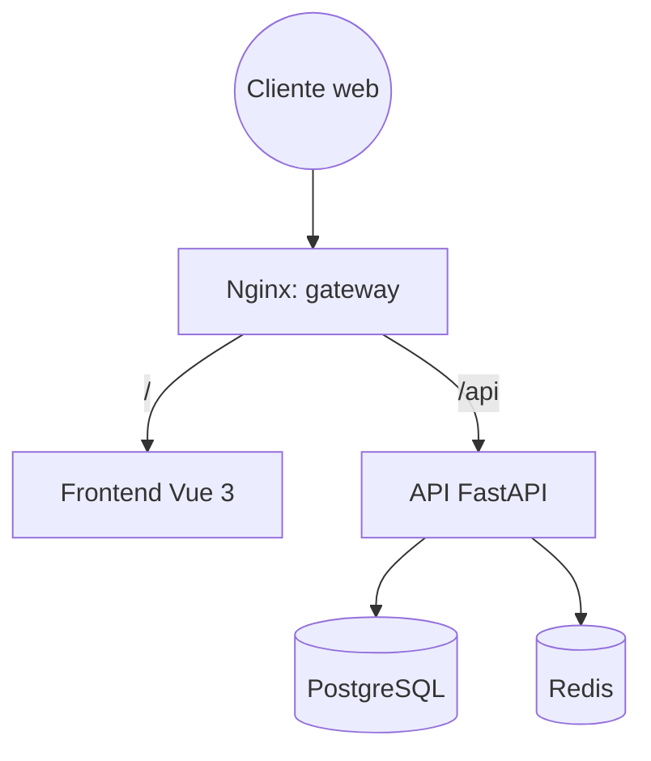

# Mis Eventos

Plataforma web para que la empresa **Mis Eventos** administre sus eventos de principio a fin: creación y publicación, programación de sesiones, inscripción de asistentes y control de capacidad, con roles diferenciados.

Este repositorio es la entrega de la prueba técnica de **Tusdatos.co** (desarrollador full stack), desarrollada con **Spec-Driven Development (SDD)**: la especificación precede al código y cada regla de negocio se cubre con tests.

> **Estado:** entrega formal **v1.0.0** de la prueba técnica, con los **seis dominios** implementados y validados (`platform`, `auth`, `events`, `sessions` y `registrations` en v1.0, y `delivery` en v1.1). El código declara `1.0.0` en `backend/pyproject.toml`, en los manifiestos del frontend y en `info.version` del OpenAPI, y la release se documenta en [CHANGELOG.md](CHANGELOG.md) con la sección `[1.0.0] - 2026-11-01`. La validación de release se ejecutó el 2026-11-01 (backend 134/134 con 96,97 % de cobertura, frontend 62/62 con 95,19 %, build de 136 módulos sin source maps, E2E transversal y limpieza total), y la auditoría del `reviewer` cerró con veredicto `¿pasa? sí`; la etiqueta anotada `v1.0.0` está publicada.

## Tabla de contenido

- [Alcance](#alcance)
- [Stack](#stack)
- [Arquitectura](#arquitectura)
- [Estructura del repositorio](#estructura-del-repositorio)
- [Metodología SDD](#metodología-sdd)
- [Estado del proyecto](#estado-del-proyecto)
- [Puesta en marcha](#puesta-en-marcha)
- [Manual de usuario](#manual-de-usuario)
- [Entorno de desarrollo (OpenCode)](#entorno-de-desarrollo-opencode)
- [Calidad](#calidad)
- [Licencia](#licencia)

## Alcance

**Requisitos funcionales**

- Gestión de eventos: CRUD, estados (`DRAFT`, `PUBLISHED`, `CANCELLED`) y búsqueda por nombre o parte del nombre.
- Autenticación con JWT y control de acceso por roles.
- Sesiones por evento con validación de horarios y capacidad propia.
- Inscripciones con control atómico de capacidad y consulta de "mis inscripciones".

**Roles**

| Rol         | Alcance                                 |
| ----------- | --------------------------------------- |
| `ADMIN`     | Visibilidad total y gestión de perfiles |
| `ORGANIZER` | CRUD de sus propios eventos y sesiones  |
| `ATTENDEE`  | Consulta del catálogo e inscripción     |

**Requisitos no funcionales**

- API REST documentada con OpenAPI.
- UI responsiva con estados de carga y feedback de acciones.
- Contenedores para frontend, backend y base de datos, con Nginx como punto de entrada único.
- Cobertura de tests en backend y frontend.

Los bonus de la prueba (roles, gestión de perfiles, imágenes WebP, lazy loading, minificación y caché con Redis) se tratan como **alcance obligatorio** (constitución, "Alcance obligatorio").

## Stack

| Capa            | Tecnología                                                                                |
| --------------- | ----------------------------------------------------------------------------------------- |
| Backend         | Python 3.14, UV, FastAPI, SQLModel/SQLAlchemy, Alembic, PostgreSQL, JWT                   |
| Frontend        | Vue 3 (Composition API) + TypeScript ligero, Vite, Vue Router, Pinia, Axios, Tailwind CSS |
| Caché           | Redis (solo lecturas, prescindible)                                                       |
| Imágenes        | Conversión a WebP en el backend (Pillow), servidas por Nginx en `/api/media/`             |
| Infraestructura | Docker, Docker Compose, Nginx                                                             |
| Pruebas         | pytest + cobertura contra PostgreSQL (backend), Vitest (frontend)                         |

## Arquitectura

Nginx es el único punto de entrada: sirve el frontend compilado en `/` y enruta `/api` al backend, lo que elimina CORS por diseño.



Detalle completo en [docs/Analisis-Arquitectonico-Funcional-Plataforma-Mis-Eventos.md](docs/Analisis-Arquitectonico-Funcional-Plataforma-Mis-Eventos.md).

## Estructura del repositorio

```
.
├── backend/            API FastAPI (dominios platform → registrations)
├── frontend/           SPA Vue 3
├── infra/              Configuración de Nginx y de PostgreSQL para los contenedores
├── specs/              Índice, plantillas y una carpeta por dominio
├── docs/               Requisitos, arquitectura, constitución y manual de usuario
├── docker-compose.yml  Orquestación de gateway, web, api, db, redis y volumen media
├── AGENTS.md           Contexto y reglas para agentes de OpenCode
├── MEMORY.md           Bitácora de decisiones y progreso
└── README.md
```

## Metodología SDD

1. Se aprueba una spec por dominio en `specs/`.
2. Se escribe el test en rojo (pytest o Vitest).
3. Se implementa lo mínimo para ponerlo en verde.
4. Se verifica el contrato OpenAPI y se registra el avance en `MEMORY.md`.

La regla de oro: **el código se subordina a la especificación**. Si el código contradice una spec, se corrige el código; si la spec estaba equivocada, se enmienda primero la spec.

| Documento                                    | Contenido                                             |
| -------------------------------------------- | ----------------------------------------------------- |
| [docs/constitution.md](docs/constitution.md) | Principios innegociables y jerarquía normativa        |
| [specs/README.md](specs/README.md)           | Dominios, orden, dependencias y estado de cada spec   |
| [specs/\_template/](specs/_template/)        | Plantillas de `spec.md`, `plan.md` y `tasks.md`       |
| [MEMORY.md](MEMORY.md)                       | Decisiones tomadas y pendientes, tropiezos y bitácora |
| [AGENTS.md](AGENTS.md)                       | Guía operativa para agentes de OpenCode               |
| [docs/manual-de-usuario.md](docs/manual-de-usuario.md) | Manual funcional de usuario paso a paso por rol (con capturas y versión HTML imprimible) |

## Estado del proyecto

El trabajo avanza por dominios: cada uno se especifica, se aprueba, se implementa con TDD y se valida antes de iniciar el siguiente.

| Orden | Dominio         | Spec                | Código       |
| :---: | --------------- | ------------------- | ------------ |
|   0   | `platform`      | Implementada (v1.0) | Implementada |
|   1   | `auth`          | Implementada (v1.0) | Implementada |
|   2   | `events`        | Implementada (v1.0) | Implementada |
|   3   | `sessions`      | Implementada (v1.0) | Implementada |
|   4   | `registrations` | Implementada (v1.0) | Implementada |
|   5   | `delivery`      | Implementada (v1.1) | Implementada |

El detalle del alcance, las dependencias y el estado oficial de cada spec está en [specs/README.md](specs/README.md); las especificaciones de `platform`, `auth`, `events`, `sessions` y `registrations` (v1.0) y de `delivery` (v1.1, auditada por el `reviewer` con veredicto `¿pasa? sí`) están en [specs/platform/spec.md](specs/platform/spec.md), [specs/auth/spec.md](specs/auth/spec.md), [specs/events/spec.md](specs/events/spec.md), [specs/sessions/spec.md](specs/sessions/spec.md), [specs/registrations/spec.md](specs/registrations/spec.md) y [specs/delivery/spec.md](specs/delivery/spec.md).

**Próximos pasos:** entrega cerrada. La etiqueta anotada `v1.0.0` está publicada sobre el commit de cierre y [CHANGELOG.md](CHANGELOG.md) es la nota de release.

## Puesta en marcha

> **Estado del entorno entregado:** el repositorio se entrega **limpio y detenido**. Los volúmenes `pg_data` y `media` se eliminaron con `docker compose down -v`, de modo que no hay datos ni imágenes de prueba. Antes de abrir `http://localhost:8080`, ejecuta `docker compose up -d --build`: las migraciones `0001 → 0005` se aplican solas y el primer `ADMIN` se siembra de forma idempotente desde `BOOTSTRAP_ADMIN_*` del `.env`.

### Requisitos

- [Docker](https://www.docker.com/) y Docker Compose.
- [UV](https://docs.astral.sh/uv/) para el backend (dependencias, Alembic y `pytest`).
- Node.js 22+ y npm 10+ para trabajar en el frontend en local (la imagen de Docker ya incorpora su propia etapa Node).

### Ejecución completa con Docker Compose

Desde la raíz del repositorio:

```bash
docker compose up -d --build
```

El gateway Nginx es el único punto de entrada y queda disponible en `http://localhost:8080`:

| Ruta                                     | Contenido                                 |
| ---------------------------------------- | ----------------------------------------- |
| `http://localhost:8080/`                 | SPA Vue 3 servida por el contenedor `web` |
| `http://localhost:8080/api/health`       | Estado de la API, PostgreSQL y Redis      |
| `http://localhost:8080/api/docs`         | Swagger UI del contrato OpenAPI           |
| `http://localhost:8080/api/openapi.json` | Documento OpenAPI generado por FastAPI    |

La configuración se toma de un `.env` local creado a partir de `.env.example`.

### Backend local

[backend/README.md](backend/README.md) contiene la documentación operativa de la API: comandos de desarrollo, comandos de Alembic, ejecución de `pytest`, generación del reporte de cobertura, requisito de PostgreSQL en contenedor y prohibición de SQLite en las pruebas.

### Frontend local

[frontend/README.md](frontend/README.md) contiene la documentación operativa de la SPA: pruebas con Vitest, cobertura, verificación de tipos con `vue-tsc`, build de producción y estructura del frontend.

### Variables de entorno

- `.env.example` versiona los marcadores de configuración (infraestructura, base de datos, Redis y aplicación) con valores de ejemplo, sin secretos reales.
- `.env` es local, está ignorado por Git y no se versiona.
- Si `.env` ya existe, se **completa por append** con las claves de aplicación que falten, sin sobrescribir ni borrar variables existentes; las variables de OpenCode/MCP (`CONTEXT7_API_KEY`, `GITHUB_PERSONAL_ACCESS_TOKEN`, `DEV_DATABASE_URI` y `BROWSER_PATH`) no se modifican.
- Nunca deben incluirse secretos reales en el repositorio (R5.7 de la constitución).
- Las variables de los servidores MCP de OpenCode (`CONTEXT7_API_KEY`, `GITHUB_PERSONAL_ACCESS_TOKEN`, `BROWSER_PATH` y `DEV_DATABASE_URI`) se conservan tal cual; sus valores reales solo viven en `.env` y no se documentan aquí.

> Los READMEs de `backend/` y `frontend/` recogen la documentación operativa de cada parte. La estructura final del frontend, el procedimiento del primer administrador y las cifras de cobertura de la release están documentados en ellos y en [CHANGELOG.md](CHANGELOG.md).

## Manual de usuario

El recorrido funcional paso a paso de la aplicación web para cada rol (**Visitante**, **Asistente (`ATTENDEE`)**, **Organizador (`ORGANIZER`)** y **Administrador (`ADMIN`)**), con capturas reales de la interfaz, matriz de permisos y guía de solución de problemas, está disponible en dos formatos:

- **Markdown (con capturas en `docs/img/manual/`):** [docs/manual-de-usuario.md](docs/manual-de-usuario.md)
- **HTML autocontenido e imprimible (A4 / PDF):** [docs/manual-de-usuario.html](docs/manual-de-usuario.html)

## Entorno de desarrollo (OpenCode)

El repositorio está desarrollado con [OpenCode](https://opencode.ai) bajo SDD. La configuración de agentes y servidores MCP vive en `opencode.json`, que **sí se versiona**: no contiene secretos y permite reproducir el mismo entorno en cualquier máquina. OpenCode lee el `.env` del proyecto y resuelve las variables con `{env:...}`.

| Variable de `.env`             | Uso                                                                     |
| ------------------------------ | ----------------------------------------------------------------------- |
| `CONTEXT7_API_KEY`             | Servidor MCP de documentación (Context7)                                |
| `GITHUB_PERSONAL_ACCESS_TOKEN` | Servidor MCP de GitHub                                                  |
| `DEV_DATABASE_URI`             | Servidor MCP de PostgreSQL en modo solo lectura (`ALLOW_WRITES=0`)      |
| `BROWSER_PATH`                 | Ruta absoluta al ejecutable de Chrome/Chromium/Brave (MCP de navegador) |

`BROWSER_PATH` es específico de cada máquina: no se versiona y no tiene valor por defecto. En Windows suele ser algo como `C:/Program Files/BraveSoftware/Brave-Browser/Application/brave.exe`; en Linux/macOS, la ruta del binario de Chrome o Chromium. Si no lo defines, el servidor `chrome-devtools-mcp` no arranca y el resto de OpenCode sigue funcionando con normalidad.

Los dos servidores MCP locales se ejecutan con `npx` y tienen **versión fijada** (`chrome-devtools-mcp@1.12.0`, `@yawlabs/postgres-mcp@0.13.9`) para que el entorno sea reproducible. Para actualizarlos, cambia la versión en `opencode.json` de forma deliberada.

> **Regla:** nunca escribas tokens, claves o contraseñas literales en `opencode.json`. Usa siempre `{env:VARIABLE}` (desde `.env`) o `{file:ruta/al/secreto}`. `.env` está en `.gitignore`; `.env.example` solo lleva marcadores de posición.

Las definiciones SDD de `.opencode/agents/` se versionan para que el flujo de trabajo sea reproducible. El resto de `.opencode/` permanece ignorado como configuración local. El coordinador dirige los pasos; el planner redacta y registra las specs; el implementer trabaja solo con una spec aprobada; el reviewer valida sin editar. Los permisos restringen las herramientas, pero las restricciones dentro de una parte de un archivo (por ejemplo, solo la columna de estado de `tasks.md`) también requieren cumplimiento del agente y revisión.

## Calidad

El Dominio 0 (`platform`) fue validado con estas comprobaciones:

| Control               | Herramienta / resultado                                                                     |
| --------------------- | ------------------------------------------------------------------------------------------- |
| Tests de backend      | `pytest` contra PostgreSQL en contenedor (`mis_eventos_test`), sin SQLite                   |
| Cobertura de backend  | 85 % con reporte XML (`backend/coverage.xml`)                                               |
| Tests de frontend     | Vitest (6 pruebas en 3 archivos)                                                            |
| Cobertura de frontend | 88.75 % de líneas                                                                           |
| Tipos del frontend    | `vue-tsc` sin errores                                                                       |
| Build de producción   | Vite minificado, con chunks por ruta diferida y sin source maps públicos                    |
| Contrato de API       | OpenAPI verificado en `/api/openapi.json` y Swagger UI en `/api/docs`                       |
| Infraestructura       | `docker compose up -d --build` con gateway Nginx, `web`, `api`, `db` y `redis` en ejecución |

El Dominio 1 (`auth`) se validó en su cierre con estas comprobaciones (resultados registrados en [MEMORY.md](MEMORY.md)):

| Control               | Herramienta / resultado                                                           |
| --------------------- | --------------------------------------------------------------------------------- |
| Tests de backend      | `pytest` contra PostgreSQL en contenedor: 43/43 (12 de `platform` + 31 de `auth`) |
| Cobertura de backend  | 94 % con reporte XML (`backend/coverage.xml`)                                     |
| Tests de frontend     | Vitest: 19/19 (6 de `platform` + 13 de `auth`)                                    |
| Cobertura de frontend | 89.17 % de líneas                                                                 |
| Tipos del frontend    | `vue-tsc` sin errores                                                             |
| Build de producción   | Vite minificado, con chunks por ruta diferida y sin source maps públicos          |
| Contrato de API       | OpenAPI con `HTTPBearer` y sin `password_hash`                                    |
| Migración             | `0002_create_users (head)` sobre PostgreSQL                                       |

El Dominio 2 (`events`) se validó en su cierre con estas comprobaciones (resultados registrados en [MEMORY.md](MEMORY.md)):

| Control               | Herramienta / resultado                                                                                      |
| --------------------- | ------------------------------------------------------------------------------------------------------------ |
| Tests de backend      | `pytest` contra PostgreSQL en contenedor: 69/69 (12 de `platform` + 31 de `auth` + 26 de `events`)           |
| Cobertura de backend  | 96 % con reporte XML (`backend/coverage.xml`)                                                                |
| Tests de frontend     | Vitest: 45/45 (19 de `platform`/`auth` + 26 de `events`)                                                     |
| Cobertura de frontend | 92.65 % de líneas                                                                                            |
| Tipos del frontend    | `vue-tsc` sin errores                                                                                        |
| Build de producción   | Vite minificado, con chunks por ruta diferida y sin source maps públicos                                     |
| Contrato de API       | OpenAPI con 6 endpoints de `events`, `EventRead` sin `image_key`, `HTTPBearer` y códigos de error declarados |
| Migración             | `0003_create_events (head)` sobre PostgreSQL                                                                 |
| Caché                 | Redis con prefijo `events:` por `scope`, TTL 60 s e invalidación en cada escritura                           |
| Medios                | Variantes WebP `400w`/`800w`/`1200w` sin EXIF servidas por Nginx con caché inmutable                         |

El Dominio 3 (`sessions`, v0.2) se validó en su cierre el 2026-11-01 con estas comprobaciones (resultados registrados en [MEMORY.md](MEMORY.md)):

| Control               | Herramienta / resultado                                                                                                                      |
| --------------------- | -------------------------------------------------------------------------------------------------------------------------------------------- |
| Tests de backend      | `pytest` contra PostgreSQL en contenedor: 98/98 (12 de `platform` + 31 de `auth` + 26 de `events` + 29 de `sessions`)                        |
| Cobertura de backend  | 97 % con reporte XML (`backend/coverage.xml`)                                                                                                |
| Tests de frontend     | Vitest: 54/54 (45 previos + 9 de `sessions`)                                                                                                 |
| Cobertura de frontend | 94.28 % de líneas                                                                                                                            |
| Tipos del frontend    | `vue-tsc` sin errores                                                                                                                        |
| Build de producción   | Vite minificado: 132 módulos, `SessionForm` en chunk diferido separado y sin source maps públicos                                            |
| Contrato de API       | OpenAPI con 5 operaciones de `sessions`, tag `sessions`, códigos `401/403/404/409/422` y sin `400`                                           |
| Migración             | `0004_create_sessions (head)` sobre PostgreSQL                                                                                               |
| Concurrencia          | `pytest -k "ses_ac_08 or ses_ac_10 or ses_ac_30"` → 3/3, con `FOR UPDATE` sobre el evento (también en `DELETE`)                              |
| E2E                   | Gateway Nginx con datos sembrados por API: catálogo, timeline, crear/editar/eliminar, permisos y `CANCELLED`; datos y claves Redis limpiados |

El Dominio 4 (`registrations`, v0.1) se validó en su cierre el 2026-11-01 con estas comprobaciones:

| Control               | Herramienta / resultado                                                                                                                                                                          |
| --------------------- | ------------------------------------------------------------------------------------------------------------------------------------------------------------------------------------------------ |
| Tests de backend      | `pytest` contra PostgreSQL en contenedor: **134/134** (98 previos + 36 de `registrations`)                                                                                                       |
| Cobertura de backend  | **97 %** con reporte XML (`backend/coverage.xml`); `app/registrations/` 100 % en `models`, `schemas`, `dependencies` y `router`, y 98 % en `service`                                             |
| Tests de frontend     | Vitest: **62/62** en 16 archivos (54 previos + 8 de `registrations`)                                                                                                                             |
| Cobertura de frontend | **95.19 %** de líneas                                                                                                                                                                            |
| Tipos del frontend    | `vue-tsc --noEmit` sin errores                                                                                                                                                                   |
| Build de producción   | Vite minificado: **136 módulos**, `EventRegistrationsList-B3wnZ5i7.js` (4.00 kB) como chunk diferido separado                                                                                    |
| Contrato de API       | OpenAPI con **6 operaciones** de `registrations`, tag `registrations`, códigos `401/403/404/409/422` y **sin `400`**                                                                             |
| Migración             | `0005_create_registrations (head)` sobre PostgreSQL                                                                                                                                              |
| Concurrencia          | `pytest -k "reg_ac_04 or reg_ac_16"` → 2 passed en **3/3** ejecuciones consecutivas, con `FOR UPDATE` en el orden `events` → `sessions`                                                          |
| Integración           | Solo cambió el cuerpo de `get_registered_count` y `get_session_registered_count`; sin cambios de contrato en `events`/`sessions`                                                                 |
| E2E                   | Gateway Nginx con datos sembrados y limpiados (`0/0/0/0`, `redis_dbsize=0`): evento lleno, sesión llena, cascada al cancelar, listado sin datos personales, consola sin errores y chunk diferido |

### Validación de release v1.0.0 (2026-11-01)

| Control            | Resultado                                                                                                                                         |
| ------------------ | ------------------------------------------------------------------------------------------------------------------------------------------------- |
| Backend            | `pytest` contra PostgreSQL en contenedor: **134 passed**, 0 failed, sin `skip`/`xfail`; cobertura **96,97 %** (97 % en el reporte `term-missing`) |
| Cobertura backend  | `backend/coverage.xml` regenerado                                                                                                                 |
| Frontend           | `Vitest`: **62 tests en 16 archivos**                                                                                                             |
| Cobertura frontend | **95,19 %** sentencias/líneas, **86,39 %** ramas, **94,35 %** funciones                                                                           |
| Tipos              | `vue-tsc --noEmit` sin errores                                                                                                                    |
| Build              | **136 módulos**, 19 chunks JS con `EventForm`, `SessionForm` y `EventRegistrationsList` diferidos, y **0 archivos `.map`**                        |
| Migración          | `0005_create_registrations (head)`                                                                                                                |
| Contrato           | `info.version = "1.0.0"`, idéntico al baseline (15 paths, 30 schemas)                                                                             |
| Stack              | `docker compose down -v` + `docker compose up -d --build`: 5 servicios operativos; `/api/health` 200                                              |
| Redis              | Detenido: `/api/health` 200 con `"redis":"degraded"`                                                                                              |
| E2E                | Recorrido `ADMIN` + `ORGANIZER` + `ATTENDEE` con limpieza total (`users=events=sessions=registrations=0`, `redis DBSIZE=0`)                       |
| Seguridad          | 0 secretos versionados, sin `password_hash` en OpenAPI ni logs, 0 `v-html`, sin CORS abierto                                                      |

Advertencias no bloqueantes de `pytest`: deprecación de `starlette.testclient` con `httpx` y aviso de longitud de clave de PyJWT (algoritmo HS256). Detalle completo en [CHANGELOG.md](CHANGELOG.md).

Los porcentajes por dominio corresponden a la última validación registrada de `platform`, `auth`, `events`, `sessions` y `registrations` en [MEMORY.md](MEMORY.md); las cifras de la release v1.0.0 son las de la corrida del 2026-11-01. La cobertura es un artefacto generado en cada ejecución y no se versiona; se regenera con los comandos documentados en los READMEs de cada parte.

La capacidad concurrente de inscripciones quedó cubierta en `registrations` (`REG-AC-04` y `REG-AC-16`, 3/3). La etiqueta anotada `v1.0.0` está publicada.

## Licencia

MIT. Consulta [LICENSE.md](LICENSE.md).

---

Desarrollado por **Sebastian Rios Sabogal** para la prueba técnica de Tusdatos.co.
