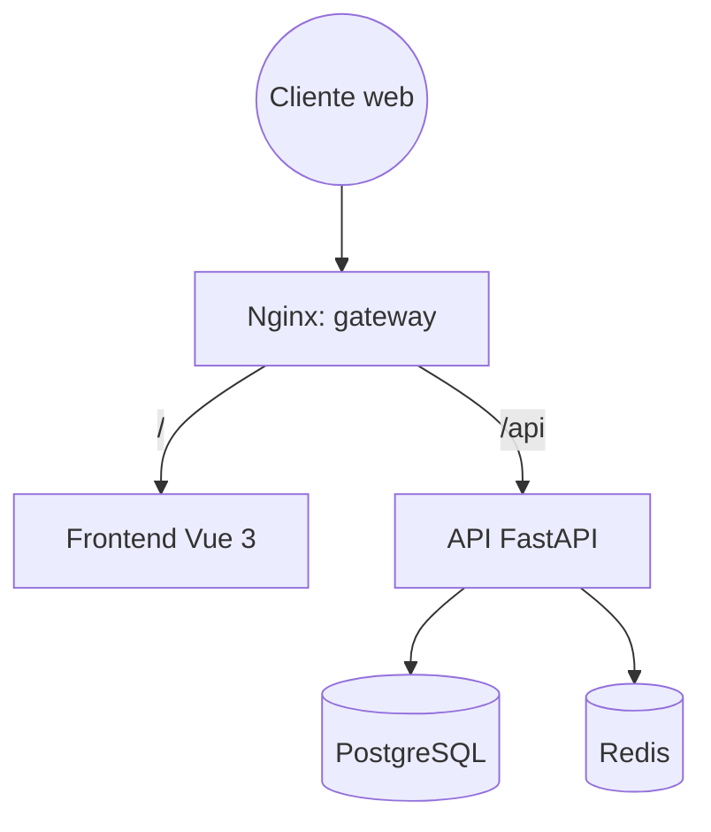

# Mis Eventos

Plataforma web para que la empresa **Mis Eventos** administre sus eventos de principio a fin: creación y publicación, programación de sesiones, inscripción de asistentes y control de capacidad, con roles diferenciados.

Este repositorio es la entrega de la prueba técnica de **Tusdatos.co** (desarrollador full stack), desarrollada con **Spec-Driven Development (SDD)**: la especificación precede al código y cada regla de negocio se cubre con tests.

> **Estado:** repositorio en fase de especificación. La base técnica y las specs de dominio están en curso; todavía no hay aplicación ejecutable.

## Tabla de contenido

- [Alcance](#alcance)
- [Stack](#stack)
- [Arquitectura](#arquitectura)
- [Estructura del repositorio](#estructura-del-repositorio)
- [Metodología SDD](#metodología-sdd)
- [Estado del proyecto](#estado-del-proyecto)
- [Puesta en marcha](#puesta-en-marcha)
- [Entorno de desarrollo (OpenCode)](#entorno-de-desarrollo-opencode)
- [Calidad](#calidad)
- [Licencia](#licencia)

## Alcance

**Requisitos funcionales**

- Gestión de eventos: CRUD, estados (`DRAFT`, `PUBLISHED`, `CANCELLED`) y búsqueda por nombre o parte del nombre.
- Autenticación con JWT y control de acceso por roles.
- Sesiones por evento con validación de horarios y capacidad propia.
- Inscripciones con control atómico de capacidad y consulta de "mis inscripciones".

**Roles**

| Rol         | Alcance                                 |
| ----------- | --------------------------------------- |
| `ADMIN`     | Visibilidad total y gestión de perfiles |
| `ORGANIZER` | CRUD de sus propios eventos y sesiones  |
| `ATTENDEE`  | Consulta del catálogo e inscripción     |

**Requisitos no funcionales**

- API REST documentada con OpenAPI.
- UI responsiva con estados de carga y feedback de acciones.
- Contenedores para frontend, backend y base de datos, con Nginx como punto de entrada único.
- Cobertura de tests en backend y frontend.

Los bonus de la prueba (roles, gestión de perfiles, imágenes WebP, lazy loading, minificación y caché con Redis) se tratan como **alcance obligatorio** (constitución, "Alcance obligatorio").

## Stack

| Capa            | Tecnología                                                                                |
| --------------- | ----------------------------------------------------------------------------------------- |
| Backend         | Python 3.14, UV, FastAPI, SQLModel/SQLAlchemy, Alembic, PostgreSQL, JWT                   |
| Frontend        | Vue 3 (Composition API) + TypeScript ligero, Vite, Vue Router, Pinia, Axios, Tailwind CSS |
| Caché           | Redis (solo lecturas, prescindible)                                                       |
| Imágenes        | Conversión a WebP en el backend (Pillow), servidas por Nginx en `/api/media/`             |
| Infraestructura | Docker, Docker Compose, Nginx                                                             |
| Pruebas         | pytest + cobertura contra PostgreSQL (backend), Vitest (frontend)                         |

## Arquitectura

Nginx es el único punto de entrada: sirve el frontend compilado en `/` y enruta `/api` al backend, lo que elimina CORS por diseño.



Detalle completo en [docs/Analisis-Arquitectonico-Funcional-Plataforma-Mis-Eventos.md](docs/Analisis-Arquitectonico-Funcional-Plataforma-Mis-Eventos.md).

## Estructura del repositorio

```
.
├── backend/      API FastAPI (dominios platform → registrations)
├── frontend/     SPA Vue 3
├── infra/        Nginx y configuración de Docker Compose
├── specs/        Índice, plantillas y una carpeta por dominio
├── docs/         Requisitos, arquitectura y constitución
├── AGENTS.md     Contexto y reglas para agentes de OpenCode
├── MEMORY.md     Bitácora de decisiones y progreso
└── README.md
```

## Metodología SDD

1. Se aprueba una spec por dominio en `specs/`.
2. Se escribe el test en rojo (pytest o Vitest).
3. Se implementa lo mínimo para ponerlo en verde.
4. Se verifica el contrato OpenAPI y se registra el avance en `MEMORY.md`.

La regla de oro: **el código se subordina a la especificación**. Si el código contradice una spec, se corrige el código; si la spec estaba equivocada, se enmienda primero la spec.

| Documento                                    | Contenido                                             |
| -------------------------------------------- | ----------------------------------------------------- |
| [docs/constitution.md](docs/constitution.md) | Principios innegociables y jerarquía normativa        |
| [specs/README.md](specs/README.md)           | Dominios, orden, dependencias y estado de cada spec   |
| [specs/\_template/](specs/_template/)        | Plantillas de `spec.md`, `plan.md` y `tasks.md`       |
| [MEMORY.md](MEMORY.md)                       | Decisiones tomadas y pendientes, tropiezos y bitácora |
| [AGENTS.md](AGENTS.md)                       | Guía operativa para agentes de OpenCode               |

## Estado del proyecto

| Orden | Dominio         | Spec      | Código    |
| :---: | --------------- | --------- | --------- |
|   0   | `platform`      | Pendiente | Pendiente |
|   1   | `auth`          | Pendiente | Pendiente |
|   2   | `events`        | Pendiente | Pendiente |
|   3   | `sessions`      | Pendiente | Pendiente |
|   4   | `registrations` | Pendiente | Pendiente |
|   5   | `delivery`      | Pendiente | Pendiente |

**Próximos pasos:** redactar la spec de `platform` (las decisiones que la bloqueaban quedaron resueltas en la arquitectura v1.1).

## Puesta en marcha

> Aún no disponible: la infraestructura y los manifiestos se crean en el dominio `platform`.

Cuando estén listos, el punto de entrada será Docker Compose desde la raíz del repositorio. La configuración se tomará de un `.env` local a partir de `.env.example`; no se versionan secretos.

La instalación, ejecución y pruebas de cada parte se documentarán en:

- `backend/README.md`
- `frontend/README.md`

## Entorno de desarrollo (OpenCode)

El repositorio está desarrollado con [OpenCode](https://opencode.ai) bajo SDD. La configuración de agentes y servidores MCP vive en `opencode.json`, que **sí se versiona**: no contiene secretos y permite reproducir el mismo entorno en cualquier máquina. OpenCode lee el `.env` del proyecto y resuelve las variables con `{env:...}`.

| Variable de `.env`             | Uso                                                                     |
| ------------------------------ | ----------------------------------------------------------------------- |
| `CONTEXT7_API_KEY`             | Servidor MCP de documentación (Context7)                                |
| `GITHUB_PERSONAL_ACCESS_TOKEN` | Servidor MCP de GitHub                                                  |
| `DEV_DATABASE_URI`             | Servidor MCP de PostgreSQL en modo solo lectura (`ALLOW_WRITES=0`)      |
| `BROWSER_PATH`                 | Ruta absoluta al ejecutable de Chrome/Chromium/Brave (MCP de navegador) |

`BROWSER_PATH` es específico de cada máquina: no se versiona y no tiene valor por defecto. En Windows suele ser algo como `C:/Program Files/BraveSoftware/Brave-Browser/Application/brave.exe`; en Linux/macOS, la ruta del binario de Chrome o Chromium. Si no lo defines, el servidor `chrome-devtools-mcp` no arranca y el resto de OpenCode sigue funcionando con normalidad.

Los dos servidores MCP locales se ejecutan con `npx` y tienen **versión fijada** (`chrome-devtools-mcp@1.12.0`, `@yawlabs/postgres-mcp@0.13.9`) para que el entorno sea reproducible. Para actualizarlos, cambia la versión en `opencode.json` de forma deliberada.

> **Regla:** nunca escribas tokens, claves o contraseñas literales en `opencode.json`. Usa siempre `{env:VARIABLE}` (desde `.env`) o `{file:ruta/al/secreto}`. `.env` está en `.gitignore`; `.env.example` solo lleva marcadores de posición.

Las definiciones SDD de `.opencode/agents/` se versionan para que el flujo de trabajo sea reproducible. El resto de `.opencode/` permanece ignorado como configuración local. El coordinador dirige los pasos; el planner redacta y registra las specs; el implementer trabaja solo con una spec aprobada; el reviewer valida sin editar. Los permisos restringen las herramientas, pero las restricciones dentro de una parte de un archivo (por ejemplo, solo la columna de estado de `tasks.md`) también requieren cumplimiento del agente y revisión.

## Calidad

| Control                      | Herramienta                                                                 |
| ---------------------------- | --------------------------------------------------------------------------- |
| Tests de backend y cobertura | pytest + reporte XML                                                        |
| Tests de frontend            | Vitest                                                                      |
| Contrato de API              | OpenAPI (Swagger en `/api/docs`)                                            |
| Reglas de negocio críticas   | Tests de capacidad concurrente y solapamiento de sesiones contra PostgreSQL |

## Licencia

MIT. Consulta [LICENSE.md](LICENSE.md).

---

Desarrollado por **Sebastian Rios Sabogal** para la prueba técnica de Tusdatos.co.
