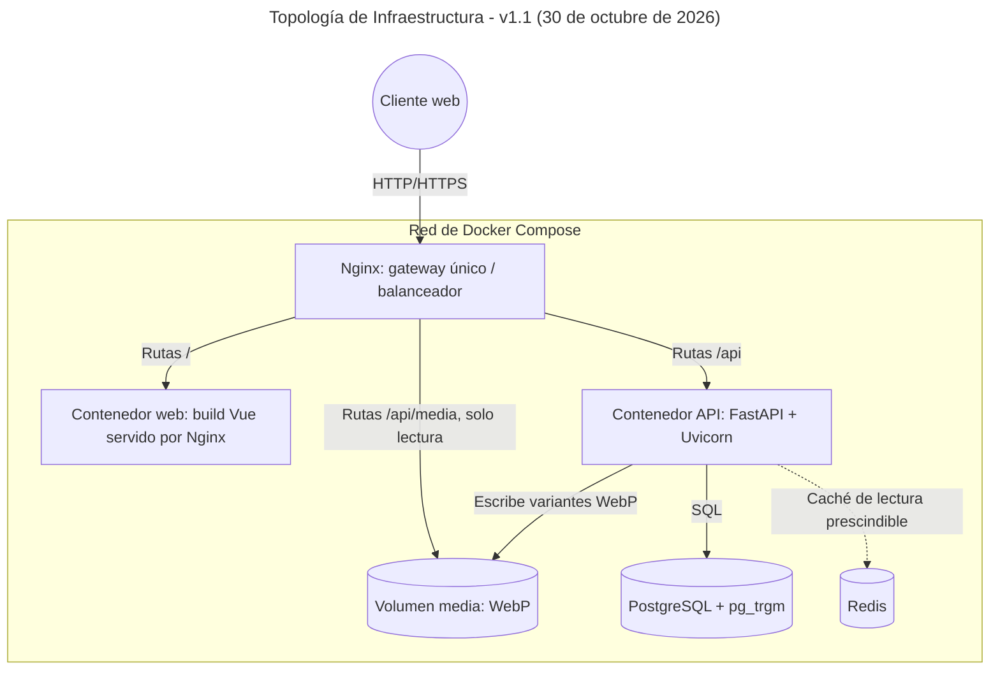
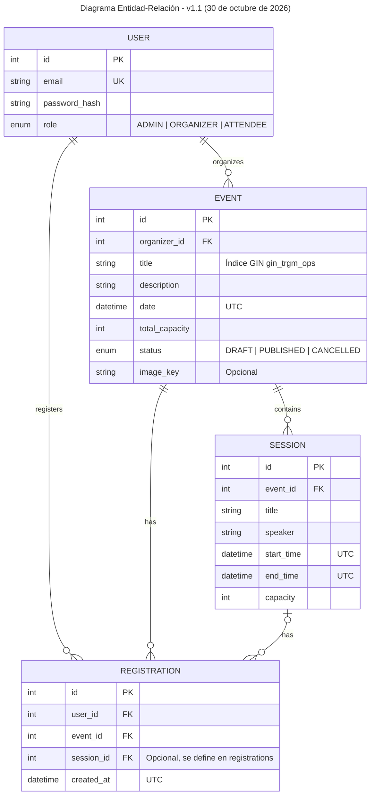
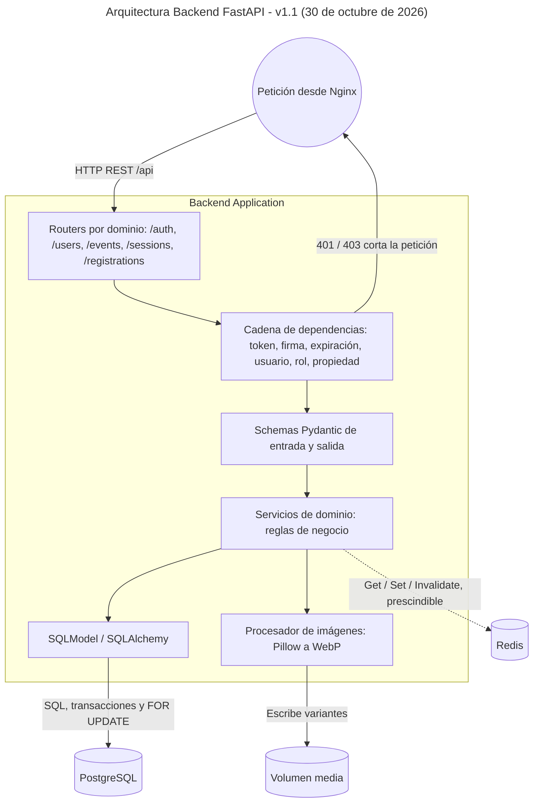
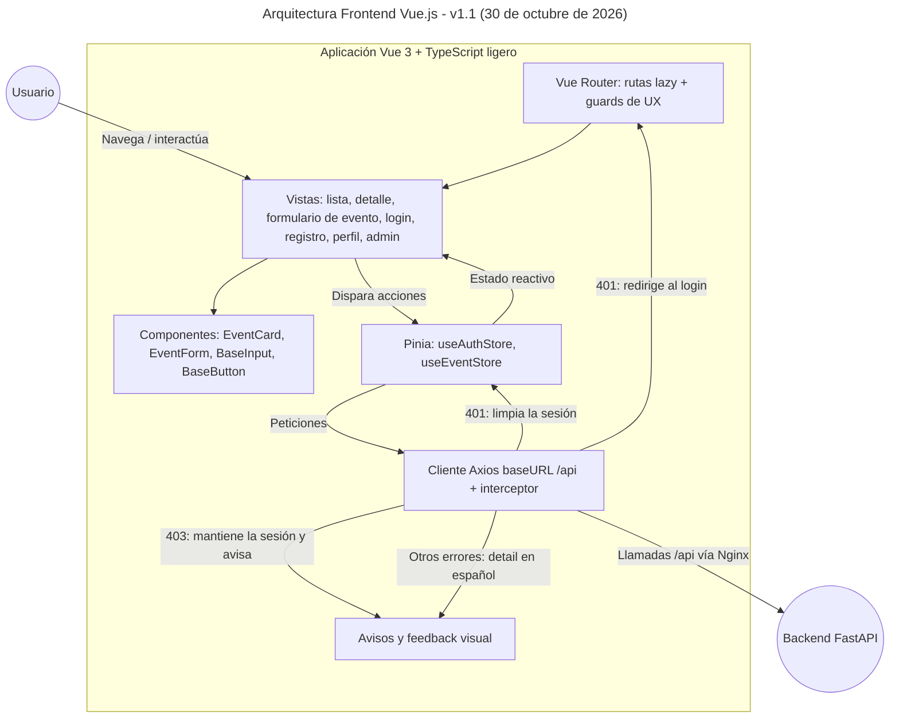

# Análisis Arquitectónico y Funcional: Plataforma "Mis Eventos"

**Versión:** 1.1
**Fecha:** Viernes, 30 de octubre de 2026
**Metodología:** Spec-Driven Development (SDD) con OpenCode
**Rango normativo:** nivel 3 de la jerarquía de `docs/constitution.md`. Está subordinado a los requisitos de la prueba técnica y a la constitución, y por encima de las specs de `specs/`.

> **Nota de evolución:** Esta versión se alinea con la **Constitución v1.1** (`docs/constitution.md`) y elimina las ambigüedades de la v1.0: fija el gestor de dependencias, la base de datos de pruebas, el tipado del frontend, la semántica de los errores 401/403 y el diseño de las imágenes WebP. Este documento define el **marco técnico global**; el comportamiento observable (contratos de API, criterios de aceptación EARS, casos límite) no se decide aquí, sino en la spec de cada dominio en `specs/`. Ante cualquier conflicto prevalece la constitución.

### Cambios respecto a la v1.0

| Tema                    | v1.0                                                   | v1.1                                                                                         | Fundamento                       |
| ----------------------- | ------------------------------------------------------ | -------------------------------------------------------------------------------------------- | -------------------------------- |
| Gestor de dependencias  | No definido                                            | **UV**                                                                                       | R4.1, velocidad de instalación   |
| Base de datos de tests  | "SQLite en memoria (o PostgreSQL)"                     | **Solo PostgreSQL en contenedor**                                                            | R3.6                             |
| Tipado del frontend     | "JavaScript moderno/TypeScript ligero"                 | **TypeScript ligero**                                                                        | R4.1                             |
| Error 403 en frontend   | Limpiaba el store y redirigía al login (incorrecto)    | **Mantiene la sesión y muestra un aviso**; solo el 401 limpia la sesión                      | R5.6                             |
| Imágenes de eventos     | Sin diseño                                             | Conversión a WebP en el backend, volumen `media` servido por Nginx en `/api/media`           | Alcance obligatorio (bonus)      |
| Contenedor web          | "Nginx ligero o Node"                                  | Nginx sirviendo el build estático de Vite                                                    | R4.5                             |
| Organización del trabajo | No descrita                                           | Por dominios funcionales (`platform` → … → `registrations`, cierre en `delivery`)            | R1.7, `specs/README.md`          |
| Valores de dominio      | Estados y roles en español                             | Valores en inglés (`DRAFT`, `PUBLISHED`, `CANCELLED`; `ADMIN`, `ORGANIZER`, `ATTENDEE`)      | R6.1                             |
| Redis                   | Caché de listados                                      | Caché de lectura **prescindible**, invalidada en cada escritura                              | R4.4                             |

## 1. Desarrollo por dominios funcionales

El sistema **no se construye por capas aisladas** (primero toda la base de datos, luego toda la API, luego todo el frontend), sino por **dominios funcionales**, cada uno especificado, probado (TDD) e implementado de extremo a extremo antes de pasar al siguiente. El orden, las dependencias y el estado de cada dominio están en `specs/README.md`:

| Orden | Dominio         | Responsabilidad                                                                    |
| :---: | --------------- | ---------------------------------------------------------------------------------- |
|   0   | `platform`      | Base transversal: contenedores, gateway, esqueletos de backend y frontend, testing |
|   1   | `auth`          | Registro, login, JWT, RBAC y gestión de perfiles por el Admin                      |
|   2   | `events`        | CRUD, estados, búsqueda trigrama, caché Redis e imágenes WebP                      |
|   3   | `sessions`      | Sesiones por evento, ponentes, horarios sin solapamiento y capacidad propia        |
|   4   | `registrations` | Inscripciones atómicas con control de capacidad y "mis inscripciones"              |
|   5   | `delivery`      | Cierre: READMEs, documentación del frontend, cobertura y verificación de OpenAPI   |

Cada dominio tiene sus tres artefactos en `specs/<dominio>/` (`spec.md`, `plan.md`, `tasks.md`) y solo se implementa con su spec en estado _Aprobada_ (R1.7, R1.8). El frontend del dominio N puede avanzar en paralelo al backend del dominio N+1 en cuanto el contrato OpenAPI de N esté congelado (R2.4).

## 2. Topología de infraestructura (capa de contenedores)

El sistema se orquesta íntegramente con `docker-compose.yml` sobre una red interna que simula un entorno de producción:

- **Gateway (Nginx):** único punto de entrada (R2.1). Enruta `/` al contenedor web y `/api` al contenedor API, lo que elimina CORS por diseño (R2.2). Además sirve `/api/media/` directamente desde el volumen de imágenes, en solo lectura (§3.8). Está preparado para balancear carga entre réplicas de la API si se escala.
- **Contenedor web (frontend):** build multi-stage: una etapa Node compila la SPA con Vite y la etapa final es un Nginx ligero que sirve los artefactos estáticos minificados.
- **Contenedor API (backend):** FastAPI bajo Uvicorn, construido sobre la imagen base `python:3.14-slim`. Las dependencias se instalan con **UV** desde el lockfile. Ejecuta las migraciones Alembic al arrancar (§3.7).
- **Base de datos (PostgreSQL):** motor relacional persistido en un volumen Docker, con integridad referencial y la extensión `pg_trgm` habilitada.
- **Caché (Redis):** caché de lectura para listados paginados y consultas de solo lectura. Es prescindible: si no está disponible, la API responde desde PostgreSQL (R4.4).
- **Volumen `media`:** almacena las variantes WebP de las imágenes de eventos. La API lo monta con escritura; Nginx, en solo lectura.
- **Configuración:** todo por variables de entorno. Se versiona `.env.example` sin valores reales; `.env` nunca se versiona (R5.7).

### Diagrama de arquitectura de infraestructura

## 3. Diseño del backend (FastAPI + SQLModel)

La API es el núcleo de las reglas de negocio (R2.5): RESTful, documentada automáticamente con OpenAPI (Swagger en `/api/docs`) y sin conocimiento del frontend (R2.3).

### 3.1. Stack y gestión de dependencias

- Python **3.14**, FastAPI, Uvicorn, SQLModel/SQLAlchemy, Alembic, PostgreSQL y JWT (R4.1).
- **Gestor de dependencias: UV** (no Poetry), elegido por su velocidad de resolución e instalación, tanto en local como en el build de Docker. El manifiesto es `backend/pyproject.toml` y las versiones se fijan en `backend/uv.lock`, que se versiona; el Dockerfile instala con el lockfile congelado.
- Las librerías de soporte (driver de PostgreSQL, cliente Redis, JWT, hashing, Pillow, `python-multipart`, utilidades de test y cobertura) se registran en `MEMORY.md` con su motivo (R4.2).

### 3.2. Organización del código por dominio

El código de `backend/` se agrupa por dominio funcional, en paralelo a `specs/`: un módulo por dominio (`auth`, `users`, `events`, `sessions`, `registrations`) con sus routers, schemas Pydantic, modelos y servicios, más un núcleo común de plataforma (configuración, conexión a base de datos, seguridad, caché y formato de error). La estructura exacta de carpetas se fija en `specs/platform/plan.md`.

### 3.3. Autenticación y seguridad (RBAC)

- JWT emitido en el login; contraseñas con hash adaptativo con sal (bcrypt o argon2, fijado en la spec de `auth`) (R5.1).
- **Una sola cadena de dependencias de FastAPI**, todo o nada, que se ejecuta antes de cualquier lógica de negocio: token presente → firma → expiración → usuario existente → rol → propiedad del recurso. El primer fallo corta la petición (R5.2).
- **401** para token ausente, inválido o expirado; **403** para usuario autenticado sin permiso (R5.6).
- Matriz de roles verificada en el servidor en cada endpoint protegido (R5.3):
  - `ADMIN`: gestión de perfiles y visibilidad total.
  - `ORGANIZER`: CRUD solo de sus propios eventos y sesiones.
  - `ATTENDEE`: lectura de eventos e inscripción.
- Schemas de salida explícitos que nunca incluyen `password_hash` (R5.5). El login responde con un mensaje genérico que no revela si el email existe (R5.8).

### 3.4. Modelo de datos (SQLModel/SQLAlchemy)

- `User`: credenciales, datos básicos de perfil y `role` (`ADMIN`, `ORGANIZER`, `ATTENDEE`). Campos de perfil definidos en la spec de `auth`.
- `Event`: entidad principal con `title`, `description`, `date`, `total_capacity`, `status` (`DRAFT`, `PUBLISHED`, `CANCELLED`), `organizer_id` y `image_key` (opcional, §3.8). Índice GIN trigrama sobre `title` para la búsqueda por nombre o parte del nombre.
- `Session`: vinculada a un evento (uno a muchos), con `title`, `speaker`, `start_time`, `end_time` y `capacity`.
- `Registration`: tabla transaccional que vincula un usuario con un evento y, opcionalmente, con una sesión. Restricción de unicidad contra inscripciones duplicadas (R5.4). El modelo exacto evento/sesión se define en la spec de `registrations`.
- Todas las fechas se almacenan en UTC.

### Diagrama entidad-relación

### 3.5. Reglas de negocio críticas

- **Inscripción atómica (R5.4):** la comprobación de capacidad (del evento y, si aplica, de la sesión) y la inserción ocurren en la **misma transacción**, con bloqueo de fila (`SELECT … FOR UPDATE`) sobre el evento o la sesión afectada. La restricción de unicidad impide duplicados. Prohibido comprobar y después insertar sin protección.
- **Sesiones sin solapamiento:** `start_time < end_time` se valida en el schema; el no solapamiento entre sesiones de un mismo evento se valida en el servicio, porque requiere consultar la base de datos. El borde exacto se define en la spec de `sessions`.
- **Estados del evento:** máquina de estados `DRAFT` / `PUBLISHED` / `CANCELLED`; la tabla de transiciones válidas se define en la spec de `events`.
- **Cupos calculados por la API:** el listado y el detalle exponen los cupos disponibles; el frontend nunca los calcula (R2.5).

### 3.6. Caché con Redis

- Cachea las respuestas de los listados paginados de eventos y otras consultas de solo lectura.
- Es **prescindible**: si Redis falla o no está disponible, la API responde desde PostgreSQL sin error para el usuario (R4.4).
- Toda escritura que afecte a un evento (creación, edición, cambio de estado, imagen, sesiones, inscripciones) invalida las entradas de caché afectadas.

### 3.7. Migraciones

Alembic controla el esquema, incluida la habilitación de `pg_trgm` y los índices trigrama. El contenedor de la API ejecuta las migraciones pendientes al iniciar, antes de levantar Uvicorn, sin pasos manuales de despliegue.

### 3.8. Imágenes de eventos (optimización WebP)

La optimización de imágenes es un bonus obligatorio. La conversión se hace en el **backend**, que es donde viven la validación y los datos; el frontend solo las presenta.

1. **Subida:** un endpoint del dominio `events` recibe la imagen en `multipart/form-data`. Solo el Organizador dueño del evento o el Admin pueden subirla o reemplazarla (R5.3). La ruta, los códigos de error y el tamaño máximo se definen en `specs/events/spec.md`.
2. **Validación:** el archivo se decodifica con Pillow (no se confía en la extensión ni en el `Content-Type`). Solo se aceptan JPEG, PNG o WebP, dentro del tamaño máximo. Se descartan los metadatos EXIF (R5.8).
3. **Conversión síncrona:** en la misma petición, sin colas ni workers (R4.3), se generan **tres variantes WebP** por ancho (orientativamente 400, 800 y 1200 px), sin ampliar imágenes más pequeñas, con compresión con pérdida de calidad media-alta (≈ 80).
4. **Almacenamiento:** las variantes se escriben en el volumen `media` con un nombre basado en un UUID, nunca en el nombre original. `Event.image_key` guarda solo esa clave. Al reemplazar la imagen o eliminar el evento se borran las variantes anteriores.
5. **Entrega:** Nginx sirve `/api/media/` directamente desde el volumen montado en solo lectura, con cabeceras de caché de larga duración (el nombre UUID cambia en cada reemplazo). El prefijo `/api` mantiene intacta la regla del gateway (R2.1). El `client_max_body_size` de Nginx se alinea con el tamaño máximo de la spec.
6. **Contrato:** las respuestas de eventos incluyen las URLs relativas de cada variante con su ancho. El frontend no construye rutas de archivos (R2.3).

### 3.9. Errores y documentación

- Formato único de error con el campo `detail` en español, incluidos los 422 de validación de FastAPI (R6). El formato exacto se define en la spec de `platform`.
- Los errores no exponen trazas, SQL ni nombres internos (R5.8).
- OpenAPI generado por FastAPI es el contrato entre backend y frontend (R2.4).

### Diagrama de arquitectura del backend (FastAPI)

## 4. Diseño del frontend (Vue 3 + Pinia)

La arquitectura del cliente prioriza la velocidad de desarrollo y la estabilidad. El frontend es un dominio independiente que solo habla con el backend por HTTP a través del gateway (Principio 2).

### 4.1. Stack y tipado

- Vue 3 con Composition API y `<script setup>`, Vue Router, Pinia, Axios, Tailwind CSS y Vitest; Vite como herramienta de build (R4.1, R4.2).
- **TypeScript ligero:** todos los componentes usan `<script setup lang="ts">`. Se tipan los stores de Pinia, los servicios de Axios (DTOs de request y response escritos a partir del contrato de la spec) y las props/emits de los componentes (`defineProps<…>()`). Sin genéricos complejos ni generadores de código a partir del OpenAPI (R4.5). La comprobación de tipos (`vue-tsc`) forma parte del build.

### 4.2. Enrutamiento (Vue Router)

- Rutas de la prueba: lista de eventos, detalle, crear/editar evento, login, registro y perfil (con "mis inscripciones"), más las vistas de administración de perfiles. Las rutas exactas se definen en las specs de cada dominio.
- Todas las rutas se cargan de forma diferida (`() => import(...)`).
- Navigation Guards (`router.beforeEach`) que leen `meta` (autenticación requerida, roles permitidos): si un `ATTENDEE` intenta entrar a una vista de administración, el router lo envía al listado general. Los guards son **ayudas de UX, no controles de seguridad**; la autorización real está en el backend (R2.5).

### 4.3. Gestión de estado (Pinia)

- `useAuthStore`: token JWT y datos del usuario autenticado; expone `isAuthenticated`, el rol y la acción para limpiar la sesión. El mecanismo de persistencia y la estrategia de expiración del token se definen en la spec de `auth`.
- `useEventStore`: listado paginado, evento actual, búsqueda y estados de carga; consume la API y mantiene en memoria la página activa.

### 4.4. Consumo de la API y semántica de errores

Un único cliente Axios con `baseURL` relativa `/api` (R2.1); nunca un host o puerto absoluto. Un interceptor global aplica esta semántica estricta (R5.6):

| Respuesta             | Comportamiento del frontend                                                                                                                                      |
| --------------------- | ---------------------------------------------------------------------------------------------------------------------------------------------------------------- |
| **401** Unauthorized  | Token ausente, inválido o expirado: **limpia `useAuthStore` y redirige al login**, conservando la ruta de origen para volver tras autenticarse, con un mensaje claro. |
| **403** Forbidden     | Usuario autenticado sin permiso: **mantiene la sesión** y **muestra un aviso** ("No tienes permisos para realizar esta acción"). No redirige al login.           |
| 404, 409, 422         | Muestra el `detail` en español devuelto por la API, junto al formulario o como notificación.                                                                     |
| 5xx o error de red    | Muestra un mensaje genérico de error; no se expone información técnica.                                                                                          |

El 401 del propio endpoint de login no dispara la redirección: se muestra el mensaje genérico de credenciales inválidas.

### 4.5. UI/UX (Tailwind CSS)

- Componentes reutilizables con nombre en inglés (R6.2): `EventCard.vue`, `EventForm.vue`, `BaseInput.vue`, `BaseButton.vue`, spinner/skeleton y notificaciones de feedback. Sin librerías de componentes UI (R4.3).
- Skeleton loaders y spinners vinculados a estado reactivo (ej. `const isLoading = ref(false)`) en cada petición HTTP, y feedback visual de éxito o error en cada acción del usuario.
- Diseño responsivo; todos los textos de la UI en español (R6).
- Prohibido `v-html` con contenido proveniente de usuarios (R5.9).

### 4.6. Rendimiento (bonus obligatorios)

- **Lazy loading:** rutas con importación dinámica y componentes pesados con `defineAsyncComponent`.
- **Minificación:** build de producción de Vite minificado (con mangling de nombres) y sin source maps públicos.
- **Imágenes:** `EventCard` y el detalle usan `` con `srcset` y `sizes` a partir de las variantes WebP que devuelve la API (§3.8), `loading="lazy"`, `decoding="async"` y dimensiones explícitas para evitar saltos de maquetación. Los recursos estáticos propios se versionan ya en WebP.
- **Caching:** la caché de datos vive en el backend con Redis (§3.6).

### Diagrama de arquitectura del frontend (Vue.js)

## 5. Estrategia de testing (aseguramiento de calidad)

El desarrollo es TDD obligatorio (Principio 3): cada criterio de aceptación `<DOM>-AC-NN` tiene al menos un test que lleva su ID en el nombre (R1.9).

- **Backend (`pytest`):**
  - Las pruebas se ejecutan **siempre contra PostgreSQL en un contenedor**, nunca contra SQLite en memoria. Es un requisito de la constitución (R3.6): el índice `pg_trgm`, el bloqueo de filas `FOR UPDATE` y las restricciones de unicidad solo se comportan de forma fiel en PostgreSQL. El mecanismo concreto (servicio o base de datos dedicada a tests) se define en `specs/platform/plan.md`.
  - Peticiones a la API con el `TestClient` de FastAPI; aislamiento por test sin datos residuales (R3.7).
  - Pruebas obligatorias (R3.4): capacidad en el límite exacto, en el límite +1 e **inscripciones concurrentes** (varias conexiones simultáneas que compiten por el último cupo); solapamiento de sesiones, incluido el borde; transiciones de estado; permisos por rol; propiedad del recurso; JWT ausente, inválido o expirado; validación y conversión de imágenes.
  - Reporte de cobertura en XML con `pytest-cov` (R3.9).
- **Frontend (`Vitest`):**
  - Pruebas unitarias de los stores de Pinia, del interceptor de Axios (401 limpia y redirige; 403 mantiene la sesión y avisa), de los guards y del renderizado de componentes (ej. el botón "Inscribirse" no aparece si el rol es `ORGANIZER`).
  - Reporte de cobertura de Vitest (R3.9).

## 6. Decisiones delegadas a las specs

Este documento no resuelve comportamiento de detalle (R1.6). Estos temas se deciden en la spec del dominio indicado:

| Tema                                                                     | Dominio         |
| ------------------------------------------------------------------------ | --------------- |
| Formato de paginación y del cuerpo de error                              | `platform`      |
| Estructura exacta de carpetas y mecanismo de la base de datos de tests   | `platform`      |
| Estrategia de JWT (token único o access + refresh) y su persistencia     | `auth`          |
| Creación del primer Admin, promoción a Organizador y campos del perfil   | `auth`          |
| Transiciones de estado, visibilidad por rol y semántica de búsqueda      | `events`        |
| Contrato del endpoint de imágenes y tamaño máximo de subida              | `events`        |
| Borde del solapamiento y relación entre capacidades de sesión y evento   | `sessions`      |
| Modelo evento/sesión de la inscripción, anulación y efecto de cancelar   | `registrations` |

---

**Estado del sistema:** arquitectura v1.1 alineada con la Constitución. Las decisiones que bloqueaban el dominio `platform` (gestor de dependencias, base de datos de tests y tipado del frontend) y el diseño de imágenes de `events` quedan resueltas aquí; el siguiente paso es redactar `specs/platform/`.
