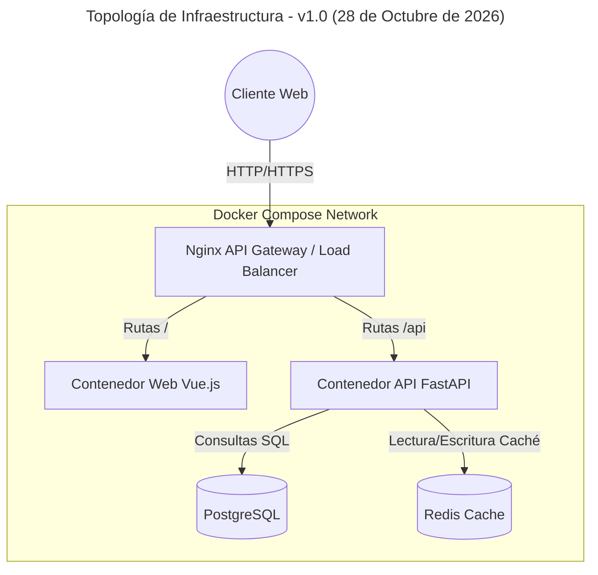
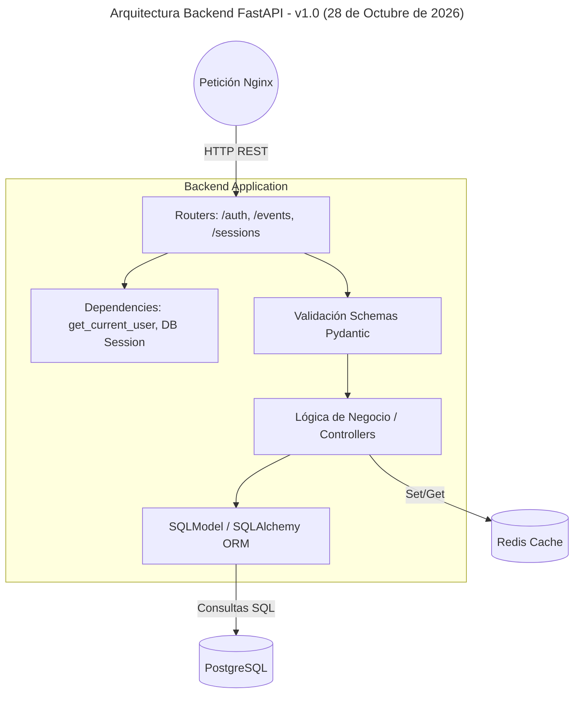
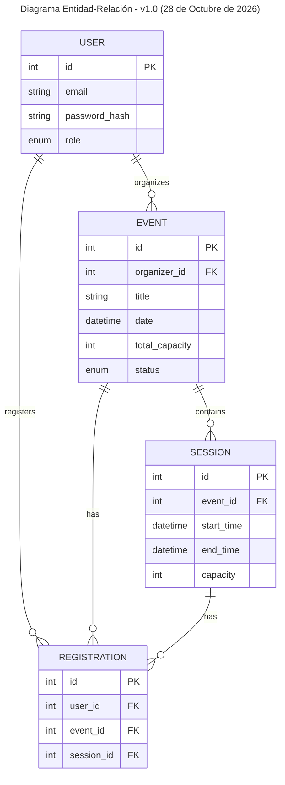
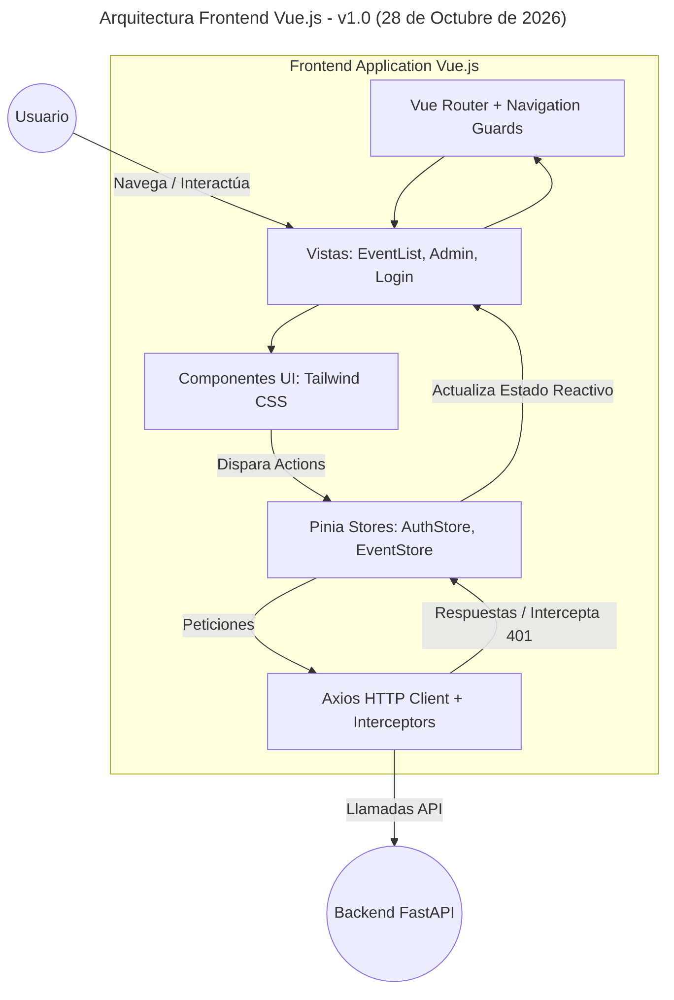

# Análisis Arquitectónico y Funcional: Plataforma "Mis Eventos"

**Versión:** 1.0
**Fecha:** Miércoles, 28 de Octubre de 2026
**Metodología:** Spec-Driven Development (SDD) con OpenCode

> **Nota de Evolución:** Dado que trabajaremos bajo la metodología estricta de Spec-Driven Development (SDD) orquestada con el agente OpenCode, este documento representa la especificación inicial (v1.0). Esta arquitectura evolucionará iterativamente a medida que se inicie el desarrollo formal del proyecto desde Visual Studio Code y se refinen los contratos técnicos.

Con las decisiones estratégicas consolidadas, el diseño del sistema ha evolucionado de un simple requerimiento a una arquitectura robusta, escalable y, sobre todo, viable para ser implementada, probada y documentada en un marco estricto de 5 días.

A continuación, presento el diseño arquitectónico final que gobernará nuestra especificación (SDD) y el desarrollo de la prueba para Tusdatos.co.

## 1. Topología de Infraestructura (Capa de Contenedores)

El sistema será orquestado íntegramente a través de `docker-compose.yml` e incluirá una capa de red enrutada para simular un entorno de producción real, destacando tu perfil de ingeniería:

- **Proxy Inverso y Balanceador (Nginx):** Actuará como el punto de entrada único (API Gateway). Redirigirá el tráfico del frontend al contenedor web y las peticiones `/api` al backend, solucionando de raíz los problemas de CORS. Está preparado para balancear carga entre múltiples réplicas de la API si se escala en el futuro.
- **Contenedor Web (Frontend):** Servidor estático (Nginx ligero o Node) sirviendo los artefactos compilados de Vue.js.
- **Contenedores API (Backend):** Instancia de FastAPI corriendo bajo Uvicorn. Construido estrictamente sobre la imagen base `python:3.14-slim` para cumplir el requerimiento técnico al milímetro.
- **Base de Datos (PostgreSQL):** Motor relacional persistido mediante volúmenes de Docker, gestionando la integridad referencial.
- **Capa de Caché (Redis):** Motor en memoria (Bonus). Reducirá la carga en PostgreSQL al cachear las respuestas de los listados de eventos paginados y consultas de solo lectura.

### Diagrama de Arquitectura de Infraestructura

## 2. Diseño del Backend (FastAPI + SQLModel)

La API será el núcleo de las reglas de negocio, diseñada bajo principios RESTful y documentada automáticamente (OpenAPI):

- **Autenticación y Seguridad (RBAC):** Implementación de JWT (JSON Web Tokens). Se integrará el Bono de Roles (Admin, Organizador, Asistente).
  - _Admin:_ Gestión de perfiles y visibilidad total.
  - _Organizador:_ CRUD de sus propios eventos y sesiones.
  - _Asistente:_ Lectura de eventos e inscripción.
- **Modelado de Datos (SQLAlchemy/SQLModel):**
  - `User`: Credenciales, datos básicos y un enum de `Role`.
  - `Event`: Entidad principal. Contiene `title`, `description`, `date`, `total_capacity`, `status` (Borrador, Publicado, Cancelado), e índices trigrama para la búsqueda por nombre.
  - `Session`: Vinculada a un evento (One-to-Many). Contiene `title`, `speaker`, `start_time`, `end_time` y `capacity`. Requerirá lógica de negocio para evitar solapamiento de horarios.
  - `Registration`: Tabla transaccional (Many-to-Many entre User y Event/Session) que validará atómicamente si `current_registrations < capacity` antes de insertar.
- **Migraciones:** `Alembic` controlará el esquema de la base de datos, garantizando que el contenedor de la API pueda ejecutar migraciones al inicializarse.

### Diagrama de Arquitectura Backend (FastAPI)

### Diagrama Entidad-Relación (Básico)

## 3. Diseño del Frontend (Vue.js 3 + Pinia)

La arquitectura del cliente prioriza la velocidad de desarrollo y la estabilidad, utilizando la _Composition API_ y `<script setup>` con JavaScript moderno/TypeScript ligero.

- **Enrutamiento (Vue Router):** Implementaremos Navigation Guards (`router.beforeEach`). Si un Asistente intenta entrar a `/admin/events`, el router interceptará la petición y lo enviará al listado general.
- **Gestión de Estado (Pinia):**
  - `useAuthStore`: Manejará el token JWT persistido (en `localStorage` o `sessionStorage`) y los datos del usuario logueado.
  - `useEventStore`: Consumirá la API, cacheará localmente la lista de eventos activa, y gestionará la paginación.
- **Lógica de Consumo (Axios/Fetch):** Crearemos un interceptor global. Si el token expira (401) o el usuario no tiene permisos (403), el interceptor limpiará el store y redirigirá al login mostrando un mensaje claro.
- **UI/UX (Tailwind CSS):**
  - Se construirán componentes atómicos: `EventCard.vue`, `BaseInput.vue`, `BaseButton.vue`.
  - Se implementarán Skeleton Loaders y/o Spinners vinculados a variables reactivas (ej. `const isLoading = ref(false)`) para otorgar feedback visual estricto en cada petición HTTP, cumpliendo el requerimiento de UI/UX.

### Diagrama de Arquitectura Frontend (Vue.js)

## 4. Estrategia de Testing (Aseguramiento de Calidad)

- **Backend (`pytest`):** Usaremos `TestClient` de FastAPI combinado con una base de datos SQLite en memoria (o PostgreSQL en un contenedor de test) para probar la validación de capacidad (ej. intentar registrar a 101 personas en un evento de 100). Se generará el reporte XML de cobertura.
- **Frontend (`Vitest`):** Pruebas unitarias sobre las funciones de los stores de Pinia y el renderizado básico de los componentes (ej. validar que el botón de "Inscribirse" no aparezca si el rol es "Organizador").

---

**Estado del Sistema:** Entendimiento total del proyecto alcanzado. La arquitectura está definida para equilibrar el despliegue avanzado (Balanceador, Redis, RBAC) con un desarrollo seguro y ágil en Vue.js.
