# Manual de usuario — Mis Eventos

| Campo | Detalle |
| --- | --- |
| **Documento** | Manual funcional de usuario paso a paso |
| **Versión del manual** | `1.0` |
| **Fecha de publicación** | `2026-11-01` |
| **Versión del producto** | Mis Eventos `v1.0.0` |
| **URL de acceso (gateway)** | `http://localhost:8080` |
| **Audiencia** | Visitantes sin cuenta, Asistentes (`ATTENDEE`), Organizadores (`ORGANIZER`) y Administradores (`ADMIN`) |

> **Nota sobre instalación y despliegue:** este documento explica el uso funcional de la aplicación web desde el navegador. Para levantar los contenedores, configurar variables de entorno o ejecutar las suites de pruebas, consulta [README.md](../README.md), [backend/README.md](../backend/README.md) y [frontend/README.md](../frontend/README.md).

---

## Tabla de contenido

1. [Cómo usar este manual](#1-cómo-usar-este-manual)
2. [Acceso y navegación general](#2-acceso-y-navegación-general)
3. [Visitante (usuario sin cuenta)](#3-visitante-usuario-sin-cuenta)
4. [Cuenta y sesión (registro, ingreso y salida)](#4-cuenta-y-sesión-registro-ingreso-y-salida)
5. [Rol Asistente (`ATTENDEE`)](#5-rol-asistente-attendee)
6. [Rol Organizador (`ORGANIZER`)](#6-rol-organizador-organizer)
7. [Rol Administrador (`ADMIN`)](#7-rol-administrador-admin)
8. [Matriz de permisos por rol](#8-matriz-de-permisos-por-rol)
9. [Mensajes frecuentes y solución de problemas](#9-mensajes-frecuentes-y-solución-de-problemas)
10. [Preguntas frecuentes y limitaciones conocidas](#10-preguntas-frecuentes-y-limitaciones-conocidas)
11. [Anexo: checklist de verificación funcional](#11-anexo-checklist-de-verificación-funcional)

---

## 1. Cómo usar este manual

### 1.1 Convenciones tipográficas

- **Elementos de la interfaz:** los nombres exactos de botones, enlaces, etiquetas de formulario y menús se muestran entre comillas angulares o en negrita, por ejemplo **«Crear evento»**, **«Inscribirme»** o **«Guardar cambios»**.
- **Rutas de navegación:** las rutas dentro del navegador se indican en formato monoespaciado, como `/`, `/login`, `/profile` o `/admin/users`.
- **Estados y roles internos:** cuando se menciona el valor técnico junto a su etiqueta visible en español, se escribe como `PUBLISHED` (**Publicado**), `DRAFT` (**Borrador**) o `CANCELLED` (**Cancelado**).
- **Datos de ejemplo:** todas las capturas y ejemplos usan cuentas sintéticas (`@example.com`) y datos ficticios.

### 1.2 Bloques de aviso

- **Nota:** información complementaria para entender el comportamiento de una pantalla.
- **Importante:** regla de negocio o restricción que impide una acción si no se cumple una condición previa.
- **Consejo:** recomendación práctica para completar una tarea más rápido.

### 1.3 Glosario rápido

| Término | Significado en Mis Eventos |
| --- | --- |
| **Evento en Borrador (`DRAFT`)** | Evento en preparación. Solo lo ven su organizador dueño y los administradores; no admite inscripciones. |
| **Evento Publicado (`PUBLISHED`)** | Evento visible en el catálogo público. Permite inscripciones de usuarios con rol **Asistente** mientras tenga cupos disponibles. |
| **Evento Cancelado (`CANCELLED`)** | Estado final e irreversible de un evento. No permite editar datos, subir imagen, modificar sesiones ni registrar nuevos asistentes. |
| **Sesión** | Actividad, charla o taller dentro de la agenda de un evento, con horario en UTC, ponente y cupo propio. |
| **Inscripción activa (`ACTIVE`)** | Reserva confirmada de un cupo en un evento o en una sesión específica. |
| **Inscripción cancelada (`CANCELLED`)** | Reserva anulada por el asistente (o en cascada al cancelar su inscripción al evento). Libera el cupo inmediatamente y puede reactivarse si el asistente vuelve a inscribirse y aún hay cupo. |
| **UTC** | Tiempo Universal Coordinado. Todas las fechas de eventos y los horarios de la agenda se almacenan y se muestran en UTC. |

---

## 2. Acceso y navegación general

### 2.1 Requisitos e ingreso

1. Asegúrate de que la plataforma esté en ejecución mediante Docker Compose (`docker compose up -d --build`).
2. Abre un navegador web moderno (Chrome, Brave, Edge o Firefox) y entra en `http://localhost:8080`.
3. Toda la aplicación funciona bajo ese único punto de entrada: la interfaz web se sirve en `/` y las peticiones a la API pasan por `/api`.

### 2.2 Barra superior de navegación

La cabecera permanece visible en todas las pantallas y adapta sus enlaces según el estado de tu sesión y tu rol:

| Estado / Rol | Enlaces visibles en la barra superior |
| --- | --- |
| **Visitante (sin sesión)** | **Mis Eventos** (inicio), **Eventos**, **Iniciar sesión**, **Registrarse** |
| **Asistente (`ATTENDEE`)** | **Mis Eventos**, **Eventos**, **Mi perfil**, **Cerrar sesión** |
| **Organizador (`ORGANIZER`)** | **Mis Eventos**, **Eventos**, **Mi perfil**, **Cerrar sesión** |
| **Administrador (`ADMIN`)** | **Mis Eventos**, **Eventos**, **Administración**, **Mi perfil**, **Cerrar sesión** |

### 2.3 Mapa de rutas de la aplicación

| Ruta | Pantalla | Quién puede acceder |
| --- | --- | --- |
| `/` | Catálogo de eventos | Todos los usuarios |
| `/events/:id` | Detalle de un evento y su agenda | Todos para eventos `PUBLISHED`; dueño `ORGANIZER` y `ADMIN` también para `DRAFT` y `CANCELLED` |
| `/login` | Inicio de sesión | Todos los usuarios |
| `/register` | Creación de cuenta nueva | Todos los usuarios |
| `/profile` | Mi perfil y Mis inscripciones | Usuarios autenticados (`ATTENDEE`, `ORGANIZER`, `ADMIN`) |
| `/events/new` | Crear evento | `ORGANIZER` y `ADMIN` |
| `/events/:id/edit` | Editar evento | `ORGANIZER` (solo si es el dueño del evento) y `ADMIN` |
| `/admin/users` | Administración de usuarios | Exclusivo para `ADMIN` |

---

## 3. Visitante (usuario sin cuenta)

Como visitante puedes explorar el catálogo público, buscar eventos por nombre y consultar la descripción, los cupos disponibles y la agenda de sesiones de cualquier evento publicado.

### 3.1 Explorar el catálogo de eventos

1. Ingresa a `http://localhost:8080/`.
2. Verás la página **«Eventos»** con la cuadrícula de tarjetas de los eventos en estado **Publicado**.
3. Cada tarjeta muestra:
   - La imagen del evento (o el recuadro **«Sin imagen disponible»** si no tiene).
   - El título y la insignia **«Publicado»**.
   - La fecha y hora en UTC.
   - El indicador **«Cupos disponibles: X de Y»**.
   - El enlace **«Ver detalle»**.
4. Cuando existan más de 10 eventos publicados, en la parte inferior aparecerá el indicador **«Página X de Y (N eventos)»** junto con los botones **«Anterior»** y **«Siguiente»**.

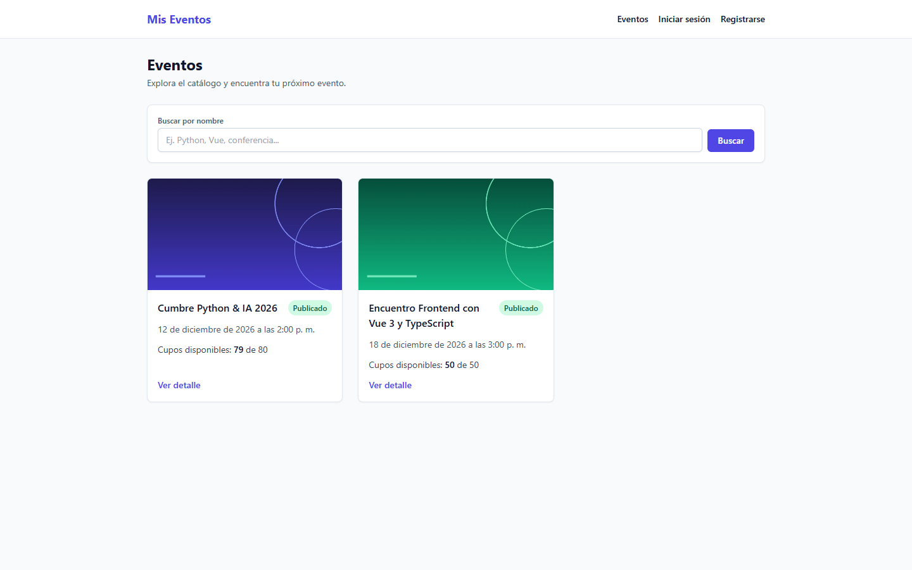
*Figura 1. Catálogo público de eventos para un visitante sin sesión iniciada.*

### 3.2 Buscar eventos por nombre

1. En el recuadro superior del catálogo, ubica el campo **«Buscar por nombre»** (admite hasta 100 caracteres).
2. Escribe una palabra o parte del título (por ejemplo, `Python` o `Vue`); la búsqueda no distingue entre mayúsculas y minúsculas.
3. Haz clic en **«Buscar»** o presiona `Enter`.
4. Para volver a ver todos los eventos, borra el texto del campo y pulsa **«Buscar»**.
5. Si ningún evento coincide, se mostrará el mensaje **«No hay eventos disponibles con los criterios seleccionados.»**

### 3.3 Consultar el detalle y la agenda de un evento

1. En la tarjeta del evento deseado, haz clic en **«Ver detalle»**.
2. Se abrirá la ruta `/events/:id` con:
   - El enlace **«← Volver al catálogo»**.
   - El título, la fecha y hora en UTC y la insignia **«Publicado»**.
   - La imagen principal en formato WebP adaptable al ancho de pantalla.
   - El bloque **«Descripción»** y tres tarjetas de resumen: **«Cupos disponibles»**, **«Inscritos»** y **«Organizador»** (`Organizador #ID`).
   - El bloque **«Agenda»**, con las sesiones ordenadas cronológicamente por hora de inicio (`HH:MM – HH:MM UTC`), ponente, descripción y la etiqueta **«X de Y cupos disponibles»**.

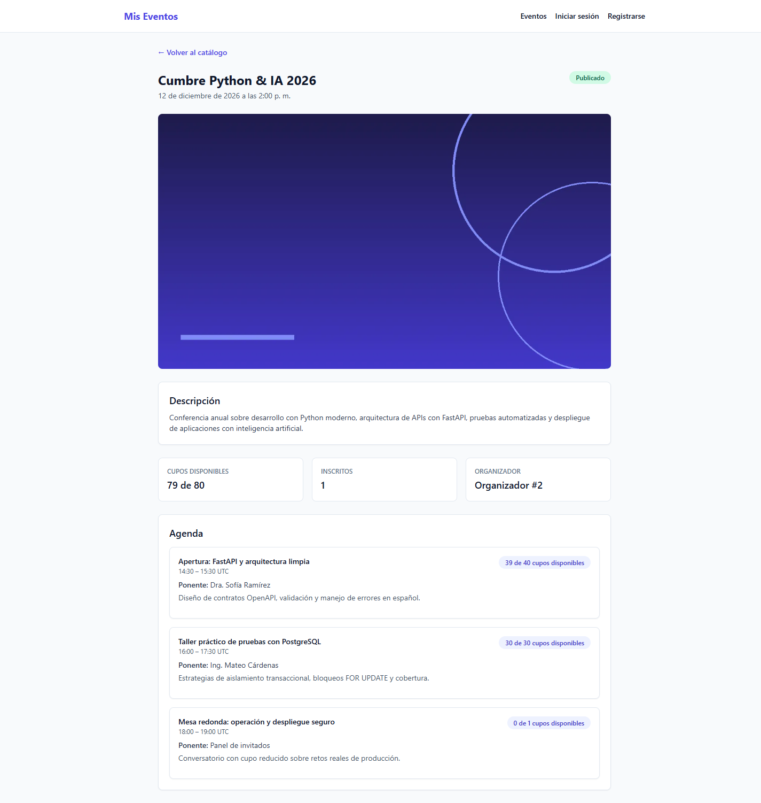
*Figura 2. Vista de detalle de un evento publicado y su agenda para un visitante anónimo.*

> **Importante (límites del visitante):** un usuario sin cuenta no ve los filtros de **Estado** ni **Mis eventos**, no puede abrir eventos en **Borrador** ni **Cancelados** (recibirá **«Evento no encontrado»**) y no ve botones de inscripción. Si intenta entrar manualmente a una ruta protegida como `/profile` o `/events/new`, la aplicación lo redirigirá a `/login` guardando la ruta de destino.

---

## 4. Cuenta y sesión (registro, ingreso y salida)

### 4.1 Crear una cuenta nueva

1. Haz clic en **«Registrarse»** en la barra superior (o entra en `/register`).
2. Completa los tres campos obligatorios del formulario **«Crear cuenta»**:
   - **Nombre completo:** entre 2 y 120 caracteres (se eliminan espacios iniciales y finales).
   - **Correo electrónico:** dirección válida de hasta 254 caracteres (se normaliza a minúsculas).
   - **Contraseña:** entre 8 y 128 caracteres; no puede estar compuesta solo por espacios.
3. Haz clic en **«Registrarse»**.
4. Si los datos son válidos, serás redirigido a `/login` y verás la notificación verde **«Cuenta creada exitosamente. Inicia sesión para continuar.»**

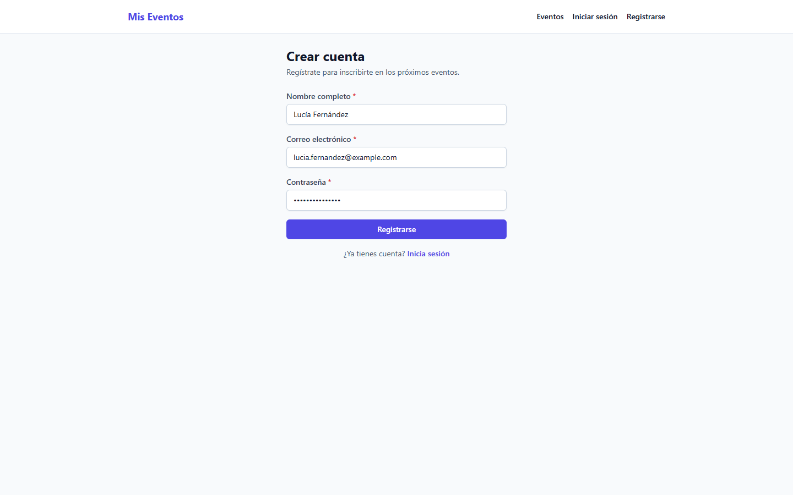
*Figura 3. Formulario de creación de cuenta nueva (`/register`).*

> **Importante:** toda cuenta creada desde el formulario público recibe automáticamente el rol **Asistente (`ATTENDEE`)** y queda activa. Ningún usuario puede autoasignarse el rol de Organizador o Administrador durante el registro; solo un Administrador puede promover cuentas desde el panel de usuarios.

### 4.2 Iniciar sesión

1. Haz clic en **«Iniciar sesión»** en la barra superior (o entra en `/login`).
2. Escribe tu **Correo electrónico** y tu **Contraseña**.
3. Pulsa el botón **«Iniciar sesión»**.
4. Si habías intentado abrir una página protegida antes de autenticarte, la aplicación te llevará automáticamente a esa página; en caso contrario, irás al catálogo principal (`/`).

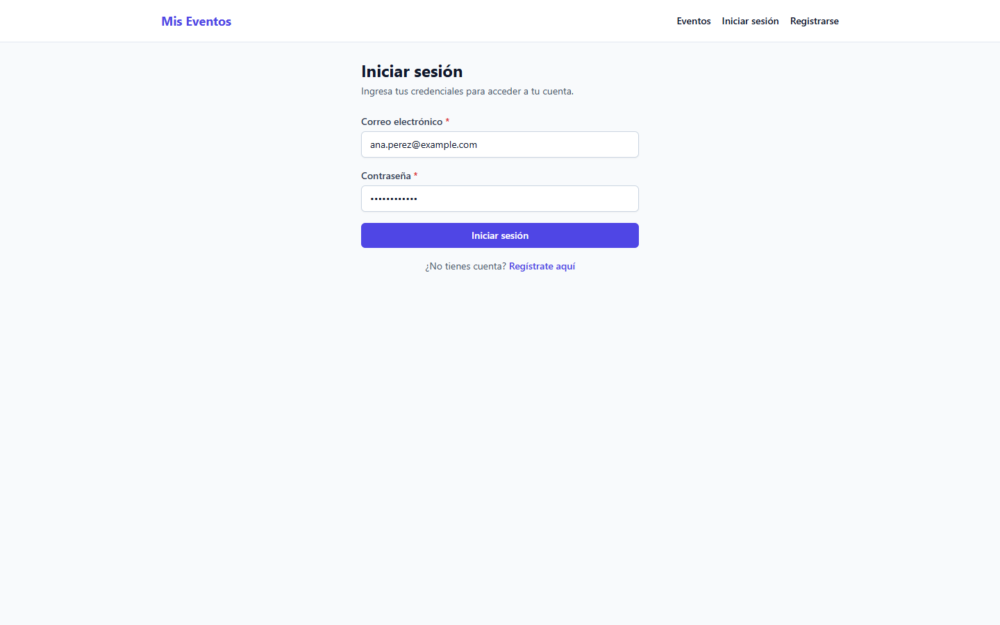
*Figura 4. Pantalla de inicio de sesión (`/login`).*

### 4.3 Persistencia de la sesión, errores `401`/`403` y cierre de sesión

- **Duración y almacenamiento:** la sesión se guarda en `sessionStorage` de la pestaña actual del navegador. Si recargas la página (`F5`), tu sesión se mantiene activa; si cierras la pestaña o el navegador, la sesión se limpia por seguridad.
- **Sesión expirada (`401`):** si tu token vence (por defecto a los 480 minutos) o tu cuenta es desactivada mientras navegas, la aplicación limpia automáticamente la sesión y te redirige a `/login` para que vuelvas a autenticarte.
- **Falta de permisos (`403`):** si intentas entrar a una sección que requiere un rol superior al tuyo (por ejemplo, un Asistente entrando a `/events/new` o `/admin/users`), **tu sesión no se cierra**: la aplicación te lleva al catálogo (`/`) y muestra el aviso amarillo **«No tienes permisos para acceder a esta sección»**.
- **Cerrar sesión manualmente:** haz clic en **«Cerrar sesión»** en la barra superior o dentro de **«Mi perfil»**. Tu sesión local se eliminará de inmediato y volverás a `/login`.

---

## 5. Rol Asistente (`ATTENDEE`)

El rol **Asistente** está diseñado para los participantes de los eventos: es el **único rol** habilitado para inscribirse a eventos y sesiones.

### 5.1 Consultar y actualizar tu perfil

1. En la barra superior, haz clic en **«Mi perfil»** (`/profile`).
2. En la tarjeta superior verás los datos de tu cuenta:
   - **Correo electrónico** (no editable).
   - **Rol:** `Asistente`.
   - **Estado de la cuenta:** `Activa`.
3. Para cambiar tu nombre visible, edita el campo **«Nombre completo»** (entre 2 y 120 caracteres) y pulsa **«Guardar cambios»**.
4. Aparecerá el mensaje verde **«Perfil actualizado correctamente.»**

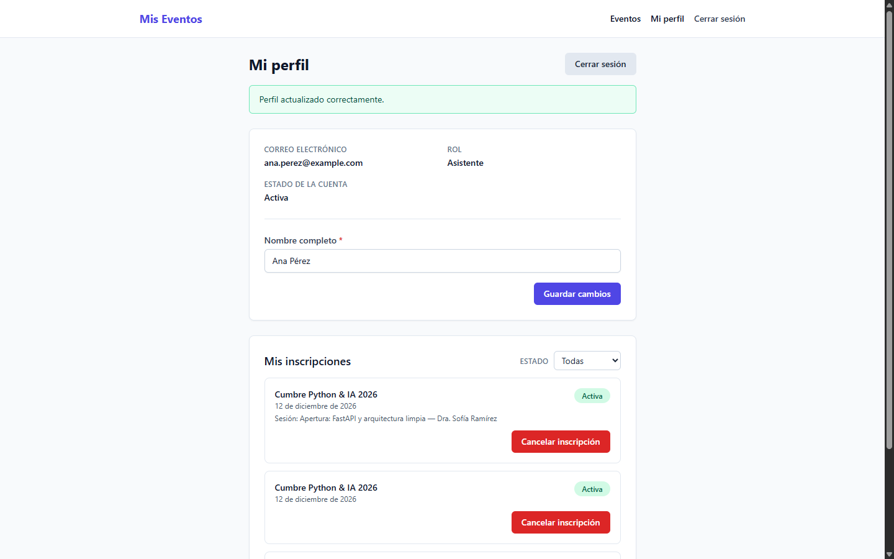
*Figura 5. Pantalla «Mi perfil» de una cuenta con rol Asistente.*

### 5.2 Inscribirse a un evento

1. Desde el catálogo (`/`), entra en **«Ver detalle»** de un evento en estado **Publicado**.
2. Al final de la página verás el bloque **«Inscripción»** (exclusivo para cuentas con rol **Asistente**).
3. Observa que, mientras no estés inscrito al evento general, los botones de las sesiones en la agenda aparecen deshabilitados junto con el aviso **«Debes inscribirte primero al evento»**.

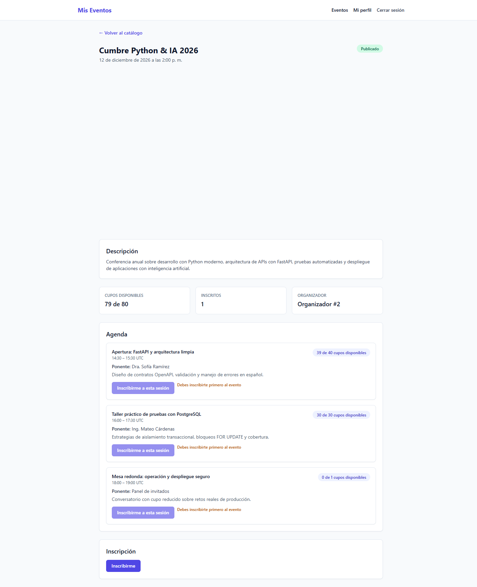
*Figura 6. Vista del asistente antes de inscribirse al evento: las sesiones requieren inscripción previa al evento.*

4. Haz clic en el botón **«Inscribirme»** dentro del bloque **«Inscripción»**.
5. De forma inmediata:
   - Verás la confirmación **«Inscripción realizada correctamente.»** (o **«Inscripción reactivada correctamente.»** si habías cancelado antes tu inscripción a ese mismo evento).
   - Aparecerá la insignia verde **«Ya estás inscrito en este evento»** y el botón rojo **«Cancelar inscripción»**.
   - El contador de **«Cupos disponibles»** del evento se actualizará y se habilitarán los botones **«Inscribirme a esta sesión»** en la agenda.

### 5.3 Inscribirse a sesiones de la agenda

1. Una vez inscrito al evento, sube a la sección **«Agenda»** dentro del mismo detalle (`/events/:id`).
2. En la sesión de tu interés, revisa la etiqueta **«X de Y cupos disponibles»** y haz clic en **«Inscribirme a esta sesión»**.
3. Verás el mensaje **«Inscripción a la sesión realizada correctamente.»** y el botón de esa sesión cambiará al estado deshabilitado **«Ya estás inscrito»**.
4. Si una sesión ya alcanzó su límite de capacidad (`0 de Y cupos disponibles`), su botón aparecerá deshabilitado junto al aviso **«No hay cupos disponibles para esta sesión»**.

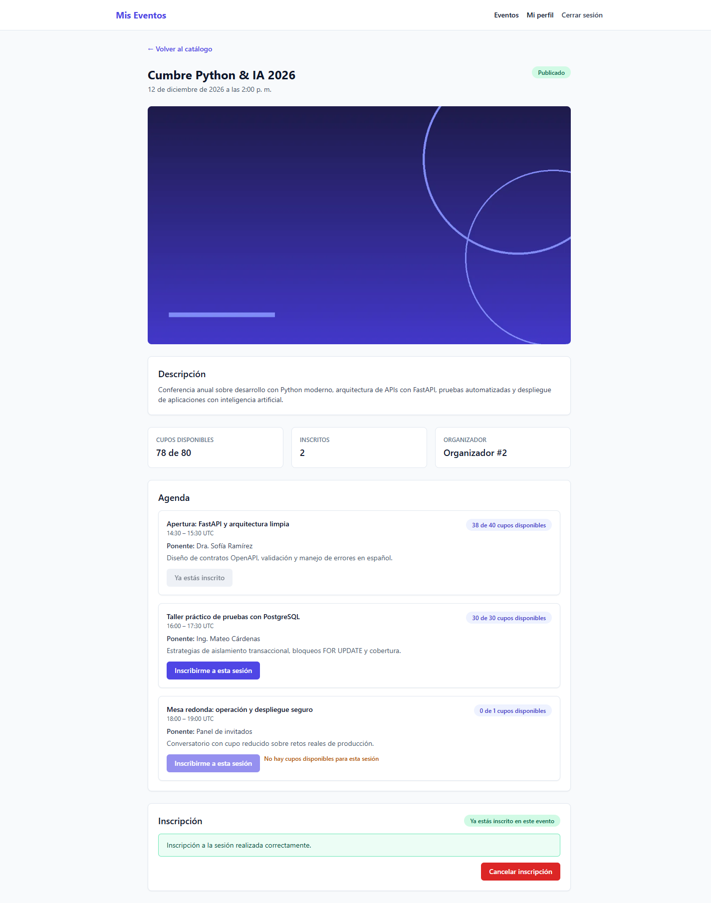
*Figura 7. Vista del asistente tras inscribirse al evento y a la primera sesión de la agenda.*

### 5.4 Consultar y filtrar «Mis inscripciones»

1. Haz clic en **«Mi perfil»** (`/profile`) y desplázate hasta el bloque **«Mis inscripciones»**.
2. Cada elemento de la lista muestra:
   - El título y la fecha del evento.
   - Si corresponde a una sesión, la línea **«Sesión: <Título> — <Ponente>»**.
   - La insignia de estado: **«Activa»** (verde) o **«Cancelada»** (gris).
3. Usa el selector **«Estado»** en la esquina superior derecha del bloque para filtrar entre **Todas**, **Activas** o **Canceladas**.
4. Si tienes más de 10 registros, utiliza los botones **«Anterior»** y **«Siguiente»** al pie de la lista.

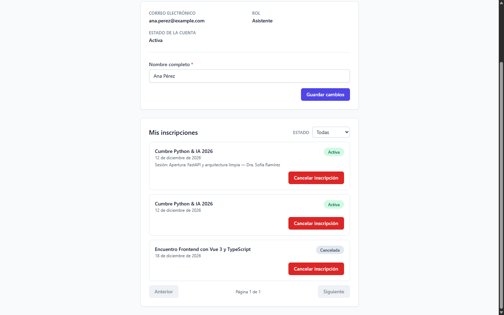
*Figura 8. Listado de «Mis inscripciones» con inscripciones activas (evento y sesión) e históricas canceladas.*

### 5.5 Cancelar una inscripción y efecto en cascada

Puedes cancelar tus inscripciones desde dos lugares:

- **Cancelar solo una sesión específica:** entra a **«Mi perfil» → «Mis inscripciones»**, ubica la tarjeta que incluye la línea **«Sesión: ...»**, haz clic en **«Cancelar inscripción»** y confirma el cuadro de diálogo **«¿Seguro que deseas cancelar esta inscripción?»**. Tu inscripción general al evento seguirá activa y se liberará únicamente el cupo de esa sesión.
- **Cancelar la inscripción al evento completo (con cascada):** puedes hacerlo tanto desde el botón **«Cancelar inscripción»** en el detalle del evento (`/events/:id`) como desde la tarjeta del evento en **«Mi perfil»**. Al confirmar:
  1. Tu inscripción al evento pasa a estado **Cancelada** y libera su cupo.
  2. **Cascada automática:** todas tus inscripciones activas a sesiones de ese mismo evento se cancelan automáticamente en la misma operación y liberan sus cupos.

> **Consejo (reactivación):** si cancelaste por error tu inscripción a un evento o a una sesión y todavía quedan cupos disponibles, basta con volver a pulsar **«Inscribirme»** o **«Inscribirme a esta sesión»**. El sistema reactivará tu registro sin duplicar filas en tu historial.

---

## 6. Rol Organizador (`ORGANIZER`)

Un usuario obtiene el rol **Organizador** cuando un Administrador actualiza su rol desde **«Administración»**. Como Organizador puedes crear eventos, subir su imagen, gestionar sus sesiones y consultar la lista de inscritos de tus propios eventos.

> **Importante:** si un Administrador acaba de cambiar tu rol a **Organizador**, recarga la página (`F5`) o vuelve a iniciar sesión para que la interfaz actualice tus permisos.

### 6.1 Catálogo con herramientas de gestión

Al entrar a `/` con una cuenta `ORGANIZER` o `ADMIN`, el catálogo añade tres controles adicionales:

1. **Botón «Crear evento»** en la esquina superior derecha.
2. **Selector «Estado»** para filtrar por **Todos los estados**, **Borrador**, **Publicado** o **Cancelado**.
3. **Casilla «Mis eventos»** para mostrar únicamente los eventos creados por tu cuenta.

> **Nota sobre visibilidad del organizador:** en el catálogo general ves todos los eventos **Publicados** de la plataforma más tus propios eventos en **Borrador** o **Cancelados**. Los borradores y eventos cancelados de otros organizadores nunca son visibles para ti.

### 6.2 Crear un evento nuevo

1. En el catálogo (`/`), haz clic en **«Crear evento»** (ruta `/events/new`).
2. Completa los campos del formulario:
   - **Título (`*`):** entre 3 y 160 caracteres.
   - **Descripción (`*`):** entre 10 y 5000 caracteres.
   - **Fecha y hora (UTC) (`*`):** selecciona la fecha y hora de inicio del evento.
   - **Capacidad total (`*`):** número entero entre `1` y `100000`.
   - **Estado:** elige **Borrador** (para seguir preparando la agenda en privado) o **Publicado** (para que sea visible de inmediato).
   - **Imagen del evento (opcional):** archivo JPEG, PNG o WebP de hasta **5 MB**. El servidor corrige la orientación, elimina metadatos EXIF y genera tres variantes WebP (`400w`, `800w` y `1200w`).
3. Haz clic en **«Guardar evento»**. Serás redirigido a la vista de detalle del nuevo evento (`/events/:id`).

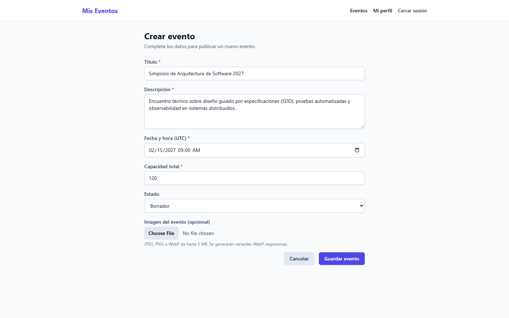
*Figura 9. Formulario «Crear evento» (`/events/new`) para Organizadores y Administradores.*

> **Importante sobre el campo «Fecha y hora (UTC)»:** aunque la etiqueta del formulario indica `(UTC)`, el selector nativo del navegador captura la fecha y hora en **tu zona horaria local** y la aplicación la convierte automáticamente a su instante equivalente en UTC al guardar. En las tarjetas y en el detalle, la fecha siempre se mostrará expresada en UTC.

### 6.3 Gestionar un evento propio (publicar, editar, imagen, cancelar y eliminar)

Dentro del detalle de un evento creado por ti (`/events/:id`), dispones de una barra de gestión debajo de la agenda con las siguientes acciones:

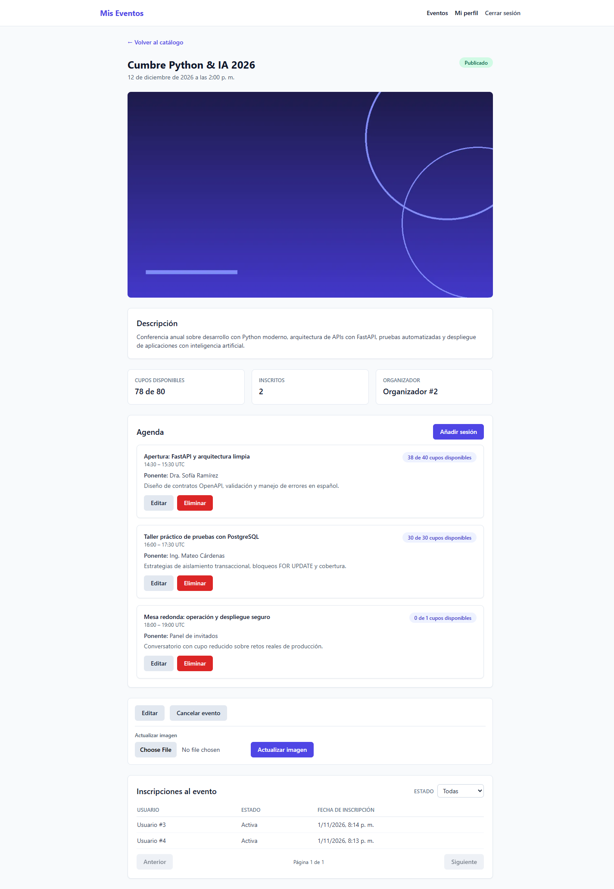
*Figura 10. Vista completa del detalle de un evento para su Organizador dueño.*

1. **Publicar un borrador:** si el evento está en **Borrador**, haz clic en el botón **«Publicar»**. El estado cambiará inmediatamente a **Publicado** sin necesidad de abrir el formulario de edición.
2. **Editar datos del evento:** haz clic en **«Editar»** (`/events/:id/edit`), modifica los campos necesarios y pulsa **«Guardar evento»**.
   - **Restricción de estado:** un evento **Publicado** no puede regresar a **Borrador** (recibirás el error `No se puede regresar un evento publicado a borrador`).
   - **Restricción de capacidad:** no puedes reducir la **Capacidad total** por debajo del número de inscritos activos actuales (`registered_count`) ni por debajo de la capacidad de alguna de sus sesiones.
3. **Actualizar la imagen principal:** en el bloque **«Actualizar imagen»** del detalle, selecciona un archivo JPEG, PNG o WebP (`≤ 5 MB`) y pulsa **«Actualizar imagen»**. Verás la confirmación **«Imagen actualizada correctamente.»**
4. **Cancelar un evento:** haz clic en **«Cancelar evento»** y confirma el aviso **«¿Seguro que deseas cancelar este evento? Esta acción no se puede revertir.»**
   - El evento pasará a estado **Cancelado** de forma permanente: ya no podrá editarse, no permitirá subir imágenes, bloqueará la creación/edición/eliminación de sesiones y dejará de mostrarse en el catálogo público.
5. **Eliminar un evento:** el botón rojo **«Eliminar»** **solo aparece cuando el evento tiene `0` inscritos activos** (`Inscritos: 0`). Si el evento ya cuenta con asistentes inscritos, el botón se oculta y el servidor impide el borrado físico para proteger el historial; en ese caso debes usar **«Cancelar evento»**.

### 6.4 Programar y gestionar sesiones de la agenda

En el bloque **«Agenda»** de un evento propio (que no esté **Cancelado**):

1. Haz clic en **«Añadir sesión»**. Se desplegará el formulario de sesión dentro de la misma página.
2. Completa los datos de la sesión:
   - **Título de la sesión (`*`):** entre 3 y 160 caracteres.
   - **Ponente (`*`):** entre 2 y 120 caracteres.
   - **Descripción (opcional):** hasta 2000 caracteres.
   - **Inicio (hora local) (`*`)** y **Fin (hora local) (`*`):** selecciona el horario en tu hora local; la aplicación lo convierte a UTC al enviar.
   - **Capacidad de la sesión (`*`):** entero entre `1` y la **Capacidad total** del evento.
3. Pulsa **«Guardar sesión»**. Verás el mensaje **«Sesión creada correctamente.»** y la sesión quedará ubicada en orden cronológico en la línea de tiempo.

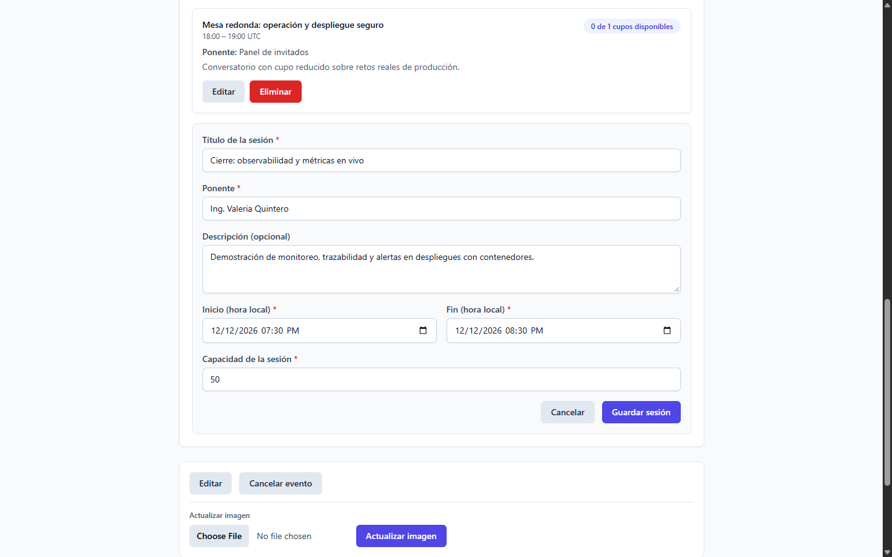
*Figura 11. Formulario desplegable para crear o editar una sesión dentro del detalle del evento.*

> **Importante (reglas de negocio de las sesiones):**
> - **Ventana del día del evento (UTC):** una sesión no puede iniciar antes de la fecha y hora de inicio del evento (`event.date`) y debe terminar dentro del mismo día UTC del evento (a más tardar a las `00:00 UTC` del día siguiente, sin cruzar la medianoche UTC).
> - **Sin solapamientos de horario:** dos sesiones del mismo evento no pueden cruzarse en horario. Como los intervalos son semiabiertos `[inicio, fin)`, una sesión puede empezar exactamente a la misma hora en que termina la anterior (por ejemplo, `14:30 – 15:30` y `15:30 – 16:30`).
> - **Capacidad máxima:** la capacidad de una sesión nunca puede superar la capacidad total del evento, ni reducirse por debajo de los asistentes ya inscritos en esa sesión.
> - **Eliminación de sesiones:** puedes editar una sesión con **«Editar»** o borrarla con **«Eliminar»** únicamente si la sesión no tiene asistentes activos inscritos; si tiene inscritos activos, el servidor rechazará el borrado con `No se puede eliminar una sesión con asistentes inscritos`.

### 6.5 Consultar el listado de «Inscripciones al evento»

Debajo de los controles de gestión del evento se muestra la tabla **«Inscripciones al evento»**:

1. Presenta todas las inscripciones al evento general con tres columnas: **Usuario** (`Usuario #ID`), **Estado** (**Activa** o **Cancelada**) y **Fecha de inscripción** (en UTC).
2. Por privacidad y protección de datos personales, la tabla muestra únicamente el identificador numérico del asistente (`Usuario #ID`), sin exponer su nombre ni su correo electrónico.
3. Puedes filtrar la tabla con el selector **«Estado»** (**Todas**, **Activas**, **Canceladas**) y navegar con **«Anterior»** y **«Siguiente»**.

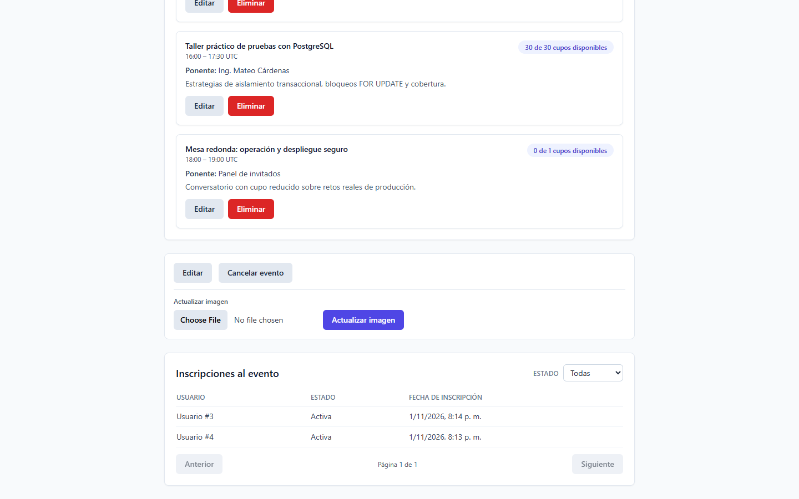
*Figura 12. Bloque «Inscripciones al evento» visible para el organizador dueño y los administradores.*

> **Importante (límites del organizador):** un usuario con rol **Organizador** no puede editar, cancelar ni ver las inscripciones de eventos creados por otros organizadores, no puede acceder a **«Administración»** (`/admin/users`) y **no puede inscribirse como asistente** a ningún evento (el bloque **«Inscripción»** no se muestra para este rol).

---

## 7. Rol Administrador (`ADMIN`)

El rol **Administrador** tiene visibilidad y control global sobre todos los eventos y sesiones de la plataforma, además del acceso exclusivo al módulo **«Administración de usuarios»**.

> **Nota sobre el primer Administrador:** al iniciar el sistema por primera vez, la API crea de forma automática e idempotente la cuenta administradora inicial a partir de las variables `BOOTSTRAP_ADMIN_EMAIL`, `BOOTSTRAP_ADMIN_PASSWORD` y `BOOTSTRAP_ADMIN_FULL_NAME` definidas por el operador en el archivo `.env`.

### 7.1 Supervisión global de eventos y sesiones

- En el catálogo (`/`), un Administrador ve **todos los eventos de todos los organizadores** en cualquier estado (**Borrador**, **Publicado** y **Cancelado**).
- Puede entrar al detalle de cualquier evento para editarlo, publicarlo, actualizar su imagen, gestionar sus sesiones, consultar su tabla de **«Inscripciones al evento»**, cancelarlo o eliminarlo (si no tiene inscritos activos).
- Cuando un Administrador edita un evento creado por un Organizador, la autoría del evento (`Organizador #ID`) se conserva intacta.
- Al igual que el Organizador, un Administrador **no puede inscribirse como asistente** a eventos ni sesiones.

### 7.2 Administración de usuarios (`/admin/users`)

1. En la barra superior, haz clic en el enlace **«Administración»** (ruta `/admin/users`).
2. Verás la pantalla **«Administración de usuarios»** con dos filtros superiores:
   - **Filtrar por rol:** **Todos los roles**, **Administrador**, **Organizador** o **Asistente**.
   - **Estado:** **Todos**, **Activos** o **Inactivos**.
3. En la tabla cada fila corresponde a una cuenta registrada y permite:
   - Ver su **Correo** electrónico.
   - Modificar su **Nombre** completo (entre 2 y 120 caracteres).
   - Cambiar su **Rol** mediante el selector desplegable (**Administrador**, **Organizador**, **Asistente**).
   - Activar o desactivar la cuenta marcando o desmarcando la casilla **Activo**.
4. Tras realizar los cambios deseados en una fila, haz clic en el botón **«Guardar»** de esa misma fila.
5. Aparecerá la confirmación verde **«Usuario actualizado correctamente»**.

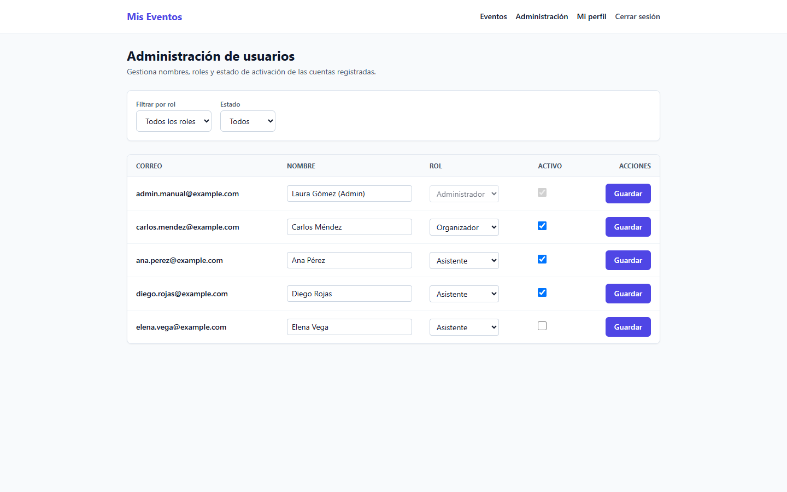
*Figura 13. Pantalla «Administración de usuarios» (`/admin/users`) exclusiva para el rol Administrador.*

### 7.3 Reglas de seguridad y autoprotección en la gestión de cuentas

- **Bloqueo de autodesactivación y cambio de rol propio:** en tu propia fila de la tabla, el selector de **Rol** y la casilla **Activo** aparecen deshabilitados. Un Administrador solo puede editar su propio nombre; no puede quitarse el rol de Administrador ni desactivar su propia cuenta.
- **Protección del último Administrador activo:** el sistema garantiza en base de datos que siempre exista al menos un `ADMIN` activo. Si intentas quitar el rol o desactivar al único Administrador activo restante, la operación se rechazará con el mensaje **«Debe existir al menos un administrador activo»**.
- **Efecto de desactivar una cuenta:** cuando desmarcas la casilla **Activo** de un usuario y pulsas **«Guardar»**, ese usuario no podrá iniciar sesión y cualquier petición que realice con un token previo recibirá un error `401`, cerrando su sesión en el navegador.

---

## 8. Matriz de permisos por rol

| Funcionalidad / Acción | Visitante (sin sesión) | Asistente (`ATTENDEE`) | Organizador (`ORGANIZER`) | Administrador (`ADMIN`) |
| --- | :---: | :---: | :---: | :---: |
| Ver catálogo de eventos `PUBLISHED` y buscar por nombre | Sí | Sí | Sí | Sí |
| Ver detalle y agenda de eventos `PUBLISHED` | Sí | Sí | Sí | Sí |
| Filtrar catálogo por estado y por «Mis eventos» | No | No | Sí | Sí |
| Ver eventos en `DRAFT` o `CANCELLED` | No | No | Solo los propios | Todos |
| Crear eventos nuevos (`/events/new`) | No | No | Sí | Sí |
| Editar, publicar, subir imagen, cancelar o eliminar evento | No | No | Solo los propios | Todos |
| Crear, editar o eliminar sesiones de la agenda | No | No | Solo en eventos propios | En cualquier evento |
| Ver tabla «Inscripciones al evento» (`Usuario #ID`) | No | No | Solo en eventos propios | En cualquier evento |
| Inscribirse / cancelar inscripción a eventos y sesiones | No | **Sí (exclusivo)** | No | No |
| Consultar y filtrar «Mis inscripciones» (`/profile`) | No | Sí | Sí (vacío salvo histórico previo) | Sí (vacío salvo histórico previo) |
| Editar su propio nombre en «Mi perfil» (`/profile`) | No | Sí | Sí | Sí |
| Administrar usuarios, roles y activación (`/admin/users`) | No | No | No | **Sí (exclusivo)** |

---

## 9. Mensajes frecuentes y solución de problemas

| Mensaje mostrado en pantalla | Cuándo ocurre | Qué hacer |
| --- | --- | --- |
| **«Credenciales inválidas»** | Al iniciar sesión con correo inexistente, contraseña incorrecta o una cuenta desactivada (`is_active = false`). | Verifica el correo y la contraseña. Si tu cuenta fue desactivada, solicita a un Administrador que vuelva a marcar la casilla **Activo** en `/admin/users`. |
| **«Ya existe una cuenta registrada con este correo electrónico»** | Al intentar registrarte en `/register` con un correo que ya está dado de alta. | Ve a `/login` e inicia sesión con esa cuenta, o usa otro correo electrónico. |
| **«No tienes permisos para acceder a esta sección»** | Al navegar a una ruta restringida para tu rol (por ejemplo, `/admin/users` sin ser `ADMIN`). | Es un aviso preventivo; tu sesión sigue activa. Si necesitas permisos de Organizador o Administrador, pídele a un `ADMIN` que actualice tu rol y luego recarga la página. |
| **«Debes inscribirte primero al evento»** | Cuando un Asistente ve la agenda de un evento publicado al que aún no se ha inscrito. | Desplázate al bloque **«Inscripción»** al final del detalle, pulsa **«Inscribirme»** y luego inscríbete a la sesión deseada. |
| **«No hay cupos disponibles para este evento»** / **«No hay cupos disponibles para esta sesión»** | Cuando `available_capacity` llega a `0`. | El cupo está completo. Solo podrás inscribirte si otro asistente cancela su inscripción o si el organizador amplía la capacidad. |
| **«El horario de la sesión se solapa con otra sesión existente del evento»** | Al guardar una sesión cuyo intervalo `[inicio, fin)` se cruza con otra del mismo evento. | Ajusta la hora de inicio o de fin para que no se cruce con las sesiones ya listadas en la agenda. |
| **«La sesión debe desarrollarse dentro de la fecha del evento ( desde el inicio del evento hasta el final del mismo día UTC )»** | Cuando la hora de inicio de la sesión es anterior a `event.date` o la hora de fin cruza las `00:00 UTC` del día siguiente. | Recuerda que los campos del formulario toman tu hora local y la convierten a UTC. Ajusta el horario para que, convertido a UTC, quede dentro del mismo día UTC del evento. |
| **«La capacidad de la sesión no puede superar la capacidad total del evento»** | Al asignar a una sesión un cupo mayor que `total_capacity` del evento. | Reduce la capacidad de la sesión o incrementa primero la capacidad total del evento desde **«Editar»**. |
| **«No se puede eliminar un evento con asistentes inscritos; cancélalo en su lugar»** | Al intentar borrar un evento que ya tiene inscripciones activas. | Usa el botón **«Cancelar evento»** en lugar de eliminarlo. |
| **«Un evento cancelado no puede cambiar de estado ni editarse»** | Al intentar modificar un evento en estado **Cancelado**. | El estado **Cancelado** es definitivo; si necesitas realizar el evento en una nueva fecha, crea un evento nuevo desde **«Crear evento»**. |
| **«La imagen supera el tamaño máximo permitido de 5 MB»** / **«Archivo de imagen inválido...»** | Al subir un archivo mayor de 5 MB o que no sea una imagen JPEG, PNG o WebP válida. | Comprime la imagen por debajo de 5 MB y asegúrate de que esté en formato `.jpg`, `.png` o `.webp`. |

---

## 10. Preguntas frecuentes y limitaciones conocidas

### 10.1 ¿Cómo convierto mi cuenta en Organizador?
Regístrate normalmente en `/register` (tu cuenta nacerá como **Asistente**) y solicita a un **Administrador** que entre a **«Administración»** (`/admin/users`), cambie tu rol a **Organizador** y pulse **«Guardar»**. Después recarga la página o vuelve a iniciar sesión.

### 10.2 ¿Puedo cambiar mi contraseña o recuperarla si la olvido?
En la versión `1.0.0` no existe cambio de contraseña desde el perfil ni recuperación por correo electrónico. El formulario de **«Mi perfil»** permite editar únicamente el **Nombre completo**.

### 10.3 ¿La plataforma envía correos de confirmación al inscribirme o cuando se cancela un evento?
No. Todas las confirmaciones se muestran de forma inmediata en pantalla y el estado actualizado puede consultarse en cualquier momento en **«Mi perfil» → «Mis inscripciones»**.

### 10.4 ¿Qué ocurre con mis inscripciones si el organizador cancela el evento?
Cuando un organizador cancela un evento, este pasa a estado **Cancelado**, deja de aparecer en el catálogo público y bloquea nuevas inscripciones. Tus inscripciones existentes se conservan en tu historial de **«Mis inscripciones»** y puedes cancelarlas desde allí si lo deseas.

### 10.5 ¿Por qué veo una diferencia de horas entre lo que ingreso en el formulario y lo que muestra la agenda?
Porque los controles `datetime-local` del navegador capturan la hora en tu huso horario local (por ejemplo, `UTC-5` en Colombia) y la aplicación la convierte y muestra siempre en **UTC** (`00:00 UTC`). Si estás en `UTC-5` e ingresas `09:00 a. m.`, el evento se guardará y se mostrará como `14:00 UTC` (`2:00 p. m. UTC`).

### 10.6 ¿Por qué el organizador ve `Usuario #3` en lugar del nombre y correo del asistente?
Por diseño de privacidad y minimización de datos personales (regla `REG-BR-13`): el listado de **«Inscripciones al evento»** expone únicamente el identificador numérico del usuario, el estado de la inscripción y la fecha de alta.

---

## 11. Anexo: checklist de verificación funcional

Puedes usar esta lista para comprobar rápidamente que todos los flujos descritos en este manual funcionan de extremo a extremo:

- [ ] **Visitante:** entrar en `/`, buscar un evento por parte del nombre y abrir **«Ver detalle»** para revisar su descripción y su agenda.
- [ ] **Registro e ingreso:** crear una cuenta en `/register`, iniciar sesión en `/login` y verificar que en la cabecera aparecen **«Mi perfil»** y **«Cerrar sesión»**.
- [ ] **Asistente — perfil:** entrar en `/profile`, actualizar el **Nombre completo** y comprobar el aviso **«Perfil actualizado correctamente.»**
- [ ] **Asistente — inscripción:** abrir un evento publicado, pulsar **«Inscribirme»**, luego pulsar **«Inscribirme a esta sesión»** en una sesión con cupo y verificar ambas inscripciones en **«Mi perfil» → «Mis inscripciones»**.
- [ ] **Asistente — cancelación en cascada:** cancelar la inscripción al evento y comprobar que tanto el evento como sus sesiones asociadas pasan a estado **Cancelada**.
- [ ] **Organizador:** iniciar sesión como `ORGANIZER`, crear un evento en **Borrador** con imagen en `/events/new`, añadir una sesión en la agenda, publicar el evento con **«Publicar»** y revisar la tabla **«Inscripciones al evento»**.
- [ ] **Administrador:** iniciar sesión como `ADMIN`, entrar en `/admin/users`, filtrar cuentas por rol o estado y actualizar el rol o el nombre de otro usuario pulsando **«Guardar»**.
